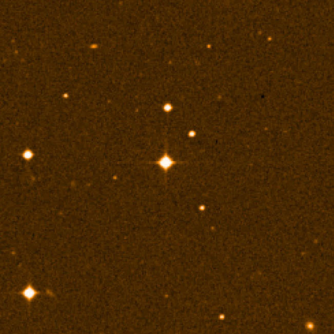

# Observed Milky Way starfield fixture

**Credit: AURA.** Source: [ESO image eso0106a](https://www.eso.org/public/images/eso0106a/).
License: [Creative Commons Attribution 4.0 International (CC BY 4.0)](https://creativecommons.org/licenses/by/4.0/),
under [ESO's image usage policy](https://www.eso.org/public/outreach/copyright/).
The full source credit is **AURA**; preserve it clearly and visibly with this image
and any derived test imagery. Online source and license links must remain active.
No endorsement by ESO or AURA is implied.

The file is the **unchanged Large JPEG** downloaded on **2026-10-29** from
<https://cdn.eso.org/images/large/eso0106a.jpg>. ESO published it on 2001-02-07,
identifies it as an observation, and lists ultraviolet U-band, the Very Large
Telescope and UVES. The image page lists no image-specific license exception;
ESO's stated default for public images is CC BY 4.0. This is not a public-domain
or blanket NASA license claim, and the photograph is not relicensed as Apache-2.0.

- Dimensions: **651 × 651** pixels.
- Byte count: **96,925**.
- SHA-256: `48a9fd312614b72b548c0c5e4b66d8ba0af9c5b76b5117828e5d39ae09dec9d6`.

[manifest.json](manifest.json) retains the exact source, download variant, credit,
license links, dates, byte identity, decoded metadata and verification limits.
The local JPEG was inspected at its original resolution; bright and faint compact
stars are visible against a textured dark background. The central cross is a
preexisting telescope-optics effect described by ESO, rather than evidence of a
new sharpening halo.

This is a **published, processed telescope U-band JPEG**. It provides real observed
star content for bounded authored-raster denoise/detail/enlargement review. It is
not Sony RAW, calibrated sensor/radiometric data, a controlled clean/noisy pair,
true-color ground truth or a physical HDR reference. Its small native dimensions
do not establish full-size astrophotography performance or star-photometry accuracy.
Content selection alone does not accept processing quality.

Keep this original file unchanged. Generated test crops and processed variants
must identify their changes, such as cropping, deterministic noise reduction,
detail sharpening and Lanczos3 enlargement, and retain the credit/source/license
clearly beside the image. Keep generated evidence outside Git. The fixture must
never appear as a demonstration photograph or be imported into a user's library
automatically.

Privacy review on 2026-10-30 covered the complete unchanged image and all 109
ExifTool metadata tags. No identifiable people, private content, GPS, device
serials or personal contact details were found. The XMP contact fields identify
ESO's [public institutional headquarters](https://www.eso.org/sci/contacts.html),
not a private home; astronomical sky coordinates are not terrestrial GPS. No
metadata was stripped. A fresh original download matched the recorded SHA-256.
This review establishes repository suitability, not processing quality.
