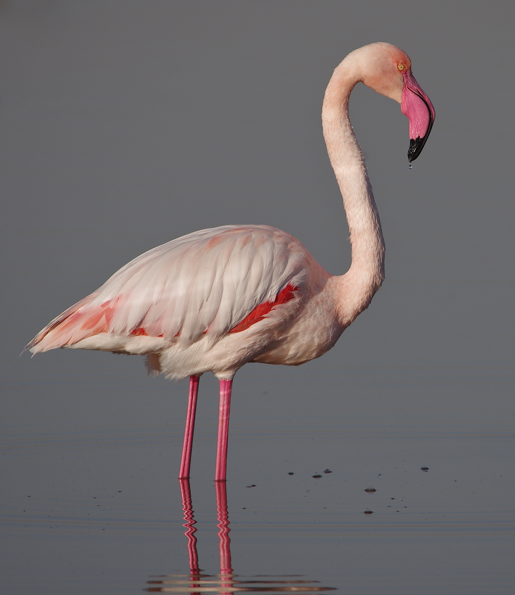

# Flamingo, water and reflected legs

**Credit: Elgollimoh, “Flamant rose Salines de Thyna.jpg”, Wikimedia Commons,
CC BY-SA 3.0.** The photographer declares this to be their own work on the
[source page](https://commons.wikimedia.org/wiki/File:Flamant_rose_Salines_de_Thyna.jpg)
and grants [Creative Commons Attribution-ShareAlike 3.0 Unported](https://creativecommons.org/licenses/by-sa/3.0/).
The [retained page revision](https://commons.wikimedia.org/w/index.php?title=File:Flamant_rose_Salines_de_Thyna.jpg&oldid=1279790151)
records that grant. See [LICENSE.md](LICENSE.md).

The unchanged published original was downloaded on **2026-11-10**:

- [Exact original download](https://upload.wikimedia.org/wikipedia/commons/a/a9/Flamant_rose_Salines_de_Thyna.jpg).
- Dimensions: **2344 × 2708**; bytes: **3,540,698**.
- SHA-256: `3b87780172e91a6986610d6632babda98bf6ab24ab6e03cdff50bd70e33db5c6`.
- Baseline 8-bit JPEG, 4:4:4, embedded `sRGB IEC61966-2.1` ICC profile.

Use this authored SDR photograph for independent local treatment of coral
plumage, surrounding water and the separately visible reflected legs. It does
not contain a complete reflected body, foliage or human skin. It is a published,
processed Pentax K-5 JPEG with existing crop/retouching settings marked already
applied; it is not a camera-original RAW, calibrated color target or true HDR
reference. Inclusion establishes reproducible input and permission, not a
photographic-quality pass.

The intake review on **2026-11-10** inspected the entire original and both
embedded JPEG previews (`PhotoshopThumbnail` and `ThumbnailImage`). They show
only the bird and water, with no identifiable people, private interiors,
documents, screens, addresses or other personal content observed. Read-only
bundled ExifTool inspection included all returned EXIF/XMP/IPTC, unknown and
MakerNote fields with `-json -G1 -a -u -U -ee3 -api RequestAll=3 -all:all`:
**278 tags**, no GPS, camera/lens serial, owner or personal contact identifiers
found. No MakerNotes were returned. Two binary thumbnail tags were extracted
and viewed. Private host dumps and previews stay outside Git. Pixels and
metadata were neither stripped nor rewritten.

Keep the JPEG unchanged. Generated proof images, crops, resized versions and
edited comparisons remain outside Git; distributed adaptations retain the
Elgollimoh credit, source/license links, a description of changes and applicable
CC BY-SA 3.0 terms. This photographic license is separate from Irodori's
Apache-2.0 default.

This shared test asset is excluded from production bundles and automatic demo
imports. [manifest.json](manifest.json) pins its provenance and limits.
