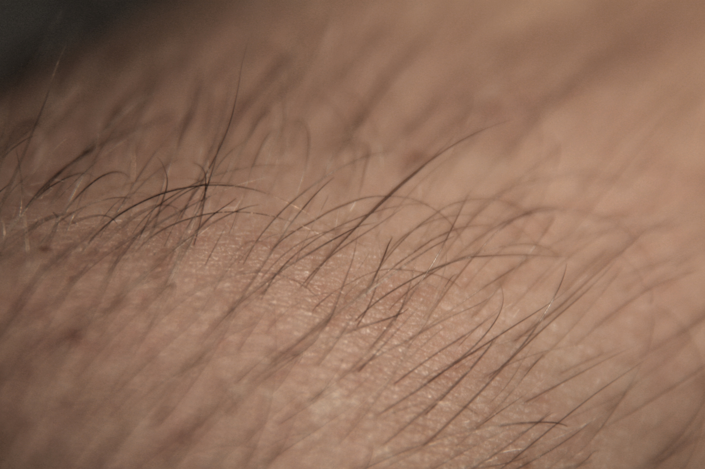

# Forearm skin and body-hair fixture

**Credit: Zephyris, “ArmHair.jpg” (archived 2010 original), Wikimedia Commons.**
License: [Creative Commons Attribution-ShareAlike 3.0 Unported (CC BY-SA 3.0)](https://creativecommons.org/licenses/by-sa/3.0/).
See [LICENSE.md](LICENSE.md) for the attribution and distribution notice.

The photographer identifies this as **own work** on the
[Commons page, retained revision 801603795](https://commons.wikimedia.org/w/index.php?title=File:ArmHair.jpg&oldid=801603795).
The file is the unchanged version originally uploaded by **Zephyris on
2010-07-02 at 22:06**, as listed in the page's file history. It was downloaded on
**2026-11-01** from this exact archived URL:

<https://upload.wikimedia.org/wikipedia/commons/archive/f/f7/20121009112621%21ArmHair.jpg>

The `20121009112621` archive identifier does not make this the later upload.
The current 2012 version uploaded by Handsdown.1 is not this fixture. Preserve the
archived URL and exact hash when obtaining another copy.

- Stored file: [originals/ArmHair.jpg](originals/ArmHair.jpg).
- Dimensions: **4272 × 2848** pixels.
- Byte count: **2,054,629**.
- SHA-256: `02f590a33003698f750166798552a63b038456c008e9f3a220ed3544b79db4b8`.

“Original” here means the unchanged archived download. This is a **published,
processed JPEG**, whose retained software tag is `Paint.NET v3.5.5`; it is not a
camera-original or RAW file. It uses baseline 8-bit JPEG with 4:2:0 chroma
subsampling. No embedded ICC profile or EXIF color-space declaration was found.
Treat it as assumed sRGB for authored-raster SDR review; that assumption is not a
measurement of the photograph's color accuracy or calibration.

The intended use is bounded SDR review of skin appearance under intensity,
mixer and grading controls, plus skin texture and individual body hairs when
evaluating denoising, sharpening and ordinary enlargement. It is not a
clean/noisy ground-truth pair, calibrated high-ISO or sensor-noise evidence,
portrait-face coverage, scene-linear color truth, or an HDR reference. Existing
JPEG processing, compression, focus and lighting are part of this input. Fixture
inclusion does not accept any processing operator or establish a quality pass.

Privacy review on **2026-11-01** covered the entire unchanged image at its native
4272 × 2848 dimensions. The intake agent and an independent root agent both
visually inspected it: skin and body hair are visible, with no face, private
documents/screens, addresses, or readily identifying marks observed. Bundled
ExifTool 13.59 read-only inspection included all returned EXIF, XMP, IPTC,
unknown and MakerNote fields with `-a -u -U -ee3 -api RequestAll=3 -all:all`:
**51 tags**, no private GPS, serial, owner or contact identifiers, and no
MakerNotes. No binary previews or thumbnails were reported; `Preview:All`
extraction produced **zero files**. No pixels or metadata were rewritten or
stripped. Private host metadata dumps and intake logs are not part of this bundle.

Keep the archived JPEG byte-for-byte unchanged. Generated crops, denoised or
sharpened images and resized variants must retain clear Zephyris credit,
source/license links and a description of their changes. Distributed adaptations
must retain the selected CC BY-SA 3.0 license. Store generated proof images and
benchmark outputs outside Git; preserve their input identity and settings.
This separate photographic license does not change Irodori's Apache-2.0 default.

This is a shared test/review asset, excluded from production application bundles.
Never use it as a demonstration photograph or import it into a user's library
automatically. [manifest.json](manifest.json) records provenance, technical
assumptions, privacy review and intended limits.
