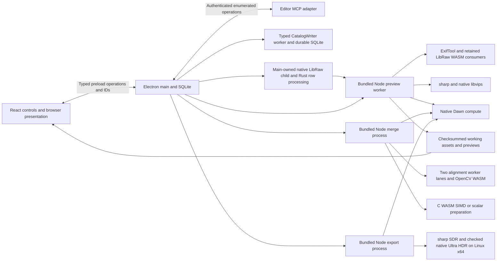

# Bazzite native-engine implementation ledger

This is the implementation and decision ledger for the new Bazzite-only native
engine phase started on October 19, 2026. It records implemented changes,
measurements and remaining acceptance gates for each feature. Individual results
do not establish acceptance of every native path or the release. The coordinator
owns integration and every hardware measurement.
There is no new work or acceptance claim for another operating system here.

The user authorizes replacing existing implementations and removing obsolete
legacy paths and backward-compatibility layers **after verified replacements**.
The earlier research-only production-preservation restriction does not govern
this phase. Routine implementation and cleanup within this objective do not
need another approval. Preserve original photographs byte-for-byte, persisted
user state and history required by the application contract, unrelated changes,
fixture attribution and failed evidence. A verified conversion may replace a
compatibility reader; retaining an old engine indefinitely is not a requirement.

This phase started with package **0.1.0**. The **0.2.0** metadata and final primary
delivery follow the accepted feature, correctness, resource, recovery and performance
evidence below. Historical checkpoints retain their original version and incomplete
status; this ledger alone does not certify an installer or another platform.

### October 23: completed Bazzite editor acceptance and final delivery

Feature, numerical, resource, recovery and ordinary-build responsiveness gates
are complete in the isolated Bazzite candidate. All **288 slider trials**, all
**72 spatial trials**, three navigation layouts and all **40 interference cases /
120 matched trials** have accepted evidence. Delivery includes consistent 0.2.0
metadata, a guarded primary overlay and focused isolated postlanding checks. The
[final delivery receipt](../artifacts/bazzite-native-20261023/final-delivery.json)
records the primary source identity, preserved inputs and validation outcomes.

Slider coverage includes eight enabled controls, Fit/100%, 60/120 Hz input and
minimum Console-open, large and maximized ultrawide layouts. The native-maximized
96 trials remain valid. The smaller 192-trial scope uses 144 original trials plus
the complete clean-focus 48-trial Console 120 rerun; four caveated original trials
are retained and excluded through their whole-case replacement. The
[accepted smaller-slider composition](../artifacts/bazzite-native-20261022/ordinary-smaller-slider-quantitative/accepted-cohort/README.md)
records unchanged source/build identity. The adopted wheel/geometry/merge-pointer
and spatial selection passed 692/0/0 in 327.66 s. The
[72-trial spatial extraction](../artifacts/bazzite-native-20261022/ordinary-spatial-quantitative/README.md)
keeps achieved input, changed-view publications, coalescing, unpresented requests
and refinement distinct. These observations do not establish physical 120 fps scanout.

Current foreground recovery and ownership cover one CPU memory-denial case,
three wide/low-budget/actual-HDR first-surface cases, four source-cache cases,
five raw-half recovery cases, nine presentation-cache cases, two interactive UI
cases and all six lifecycle cases. The two failed native-CPU lifecycle observers
passed their exact 19.14 s rerun after observing the real native request/published
pair; the earlier 20-pass/2-failure invocation remains mixed evidence. The exact
65-photo disclosure/Trash case passed in 23.95 s with original-preservation checks.
Current E masks retain full actual-Electron photographic/threshold/primitive
agreement and four application lifecycle passes; retired D remains a historical failure.

The final [saved-data composition](../artifacts/bazzite-native-20261023/final-quantitative-extraction/reports/final-current-complete-20261023/summary.md)
contains 40 unique interference cases, each with three matched repetitions, with
no extraction issues. Every workload has eight accepted controls and 24 matched
trials. Actual import counters or native export/merge producers advance during
editing, with verified durable results. Whole-task slowdown is reported separately.

| Workload                | Controls / matched trials | Minimum changed-visible updates/s during overlap | Worst overlap p95 / p99 / maximum | Median / maximum task slowdown |
| ----------------------- | ------------------------: | -----------------------------------------------: | --------------------------------: | -----------------------------: |
| Import                  |                    8 / 24 |                                            59.70 |             14.8 / 19.5 / 32.0 ms |                 2.981 / 3.014× |
| Individual export       |                    8 / 24 |                                            59.79 |             16.0 / 28.1 / 62.6 ms |                 1.688 / 1.743× |
| Nine-photo batch export |                    8 / 24 |                                            60.01 |             15.7 / 17.2 / 29.2 ms |                 1.079 / 1.095× |
| Nine-source noise merge |                    8 / 24 |                                            59.74 |             16.8 / 26.1 / 40.3 ms |                 1.014 / 1.030× |
| HDR bracket merge       |                    8 / 24 |                                            59.54 |             16.0 / 23.6 / 65.0 ms |                 1.006 / 1.081× |

The October 22 HDR run stopped within its authorized desktop window with six
passed cases, interrupted Temperature and unrun Tint. Its interrupted Temperature
receives no partial credit. On October 23, Temperature completed all three matched
repetitions and the coordinator observed its genuine Playwright pass. The containing
run later stopped during Tint evidence writing, so no aggregate Playwright summary
exists for that run. The [case-specific Temperature receipt](../artifacts/bazzite-native-20261023/observed-temperature-case-acceptance.json)
combines that explicitly relayed observation with 71 saved-data/source checks,
61 current source pins, the byte-identical full payload/attachment and six verified
masters. The attachment is written before final assertions and is not sufficient
alone. The interrupted Tint payload remains excluded. The complete exact Tint
rerun then passed 1/0/0 in 130.566 s under a fresh authorized window, with its genuine
[Playwright summary](../artifacts/verification/ordinary-hdr-tint-verified-VN6fhv/playwright/summary.json).
No aggregate summary or verbatim saved Temperature stdout was fabricated.

The failed initial GNOME wrapper treated a literal `--` as the command and launched
no application. A later PTY/job-control launcher stopped before app execution;
plain pipes and a successful wrapper preflight resolved that launch issue. These
attempts stay retained. The final run ended before the agreed deadline, originals
were checked, and root confirmed no owned runtime processes or remaining inhibitors.
Unrelated Chrome inhibitors were preserved while present. No unanswered extension
was assumed, and no desktop preference or brightness setting changed.

Current catalog 17/settings 7, writer/history/rejection, canonical/photographic
quality, linear64 program/GPU precision, native full-F32/source/lifecycle, the RAW
15% regression gate, native Auto encoder and scoped resource proofs remain valid.
The independent three-case recovery-color corpus is source-equivalent through a
local identifier rename; application device-loss/CPU recovery has separate proof.
Managed Automatic/custom RAM/VRAM budgets, owner cleanup and before/after PSS/RSS/DRM
snapshots retain their scopes; no continuous physical-memory peak or global cap is claimed.

All 551 protected primary preimages/absences, the original nine changes and native
source/binary pins passed the fresh [October 23 readiness audit](../artifacts/bazzite-native-20261023/source-readiness-20261023.json).
Final landing must refresh the old delivery payload for current accepted harness,
provenance, documentation and version changes. Keep both Git histories unchanged
and use the guarded explicit overlay, followed by isolated postlanding checks.

Editor responsiveness during merge work does not close the older whole-merge
10-second median / 12-second maximum visible workflow, separate 15-second visible
checkpoint or five-second service stretch. Backlog 31 remains open for those and
the separate frozen merge/default-adoption work. macOS acceptance is separate.

### October 22: retained foreground attempts and test-observer repairs

The first individual-export family stopped with 1 pass, 3 failures, 1 interruption and
3 unrun cases in 274.425 s. Its unchanged exact Contrast rerun failed six actual
producer-progress assertions in 61.86 s. Diagnosis showed the neutral driver prelude
could commit an older Contrast value after export started, correctly aborting and
retrying the admitted task. The export-only setup now restores the full canonical
neutral baseline before producer start. A later non-import predicate extends
that same setup to merge cases; import and export outcomes remain equivalent.
Production bytes, shared sustained driver, numerical assertions, sample counts
and thresholds did not change. These failures stay failures of their attempts.

The corrected individual group then passed six cases but failed Whites when idle
repetition 1 changed target headroom 23.474→70.422 and generation 3→4. The complete
Whites case passed its stable-display exact rerun in 53.458 s; only the six accepted
cases from the mixed invocation enter the final matrix. A transient GNOME
session-idle inhibitor was recorded for later long cohorts without changing
preferences or brightness. Idle dimming is a plausible environmental risk;
historical causation is unproven. Display/focus guards remain strict, and the
failed target-transition result is preserved. The Console 120 focus-caveated scope
likewise has a complete clean 48-trial replacement rather than a waived guard.

### Retired standalone viewport experiment

The unused ten-file `native/luma-engine` winit/wgpu host was retired from the
active source tree after a fresh byte-for-byte archive (175,793 bytes). Its
[manifest](../artifacts/bazzite-native-20261019/archived-winit-viewport/manifest.json)
retains every source, lockfile and schema hash. All failed/incomplete measurements
and old source snapshots remain. The active F32 fixture generator, native CPU
comparisons and separate registered `research-wgpu` crate are unchanged. The
[bounded integration assessment](native-viewport-research.md) remains as research;
this cleanup adopts no alternate renderer and requires no new GPU workload.

### Earlier October 22 checkpoint: CPU recovery and preserved integration

This retained checkpoint predates the completed foreground cases above. Its
background selection for `native-cpu-preview-ui`, `background-import`
and `stack-range-selection-ui` has **683 passes, zero failures and two explicitly
deferred native cases in 310.22 seconds**:
[registered report](../artifacts/verification/2026-10-22T08-54-21.136Z-check-eouu0F/summary.md).
Type checking, lint, formatting and the ordinary build passed. All six compatible
CPU-recovery cases, three background-import cases and eight grouped-selection
cases passed. Exit 2 records incomplete foreground coverage, not a complete pass.

This exposed and fixed a real clipping retry defect: after a temporary resource
denial, a newly adopted normal CPU frame could share the previous frame's
publication key, preventing analysis from retrying. The key now includes the
adopted pair identity. The genuine clipping consumer retries and draws its mask;
the numerical algorithms, resource admission and cancellation contracts are
unchanged. The bitmap-drain test also follows the stronger current retirement
barrier: the next source stays neutral until the old receiver actually closes,
before any new GPU allocation. Both exact failed cases passed before this full
target selection.

Hidden import checks retain transfer progress, minimum-size geometry, reload,
cancellation, staging cleanup and actual quit assertions. Optional captures use
the native shared path in foreground mode; post-resize buttons use the existing
keyboard activation helper. One complete 65-photo deletion case requires a visible
Wayland window: its trusted End key reaches the focused overflowing list without
scrolling, and hidden-safe capture stalls. Its disclosure, keyboard and exact Trash
assertions remain intact for the next foreground batch. The other deferred case
checks CPU memory denial and native 100% redraw after resize.

The earlier current first-surface selection retained **669 passes, zero failures
and three native-display deferrals in 58.05 seconds**:
[first-surface report](../artifacts/verification/2026-10-22T08-11-01.070Z-check-5bLKxW/summary.md).
It verifies actual fencing, orientation, stale-source cancellation and ownership;
the wide-budget/display cases still need foreground acceptance. Current export
context checks also passed all 22 cases in the preceding mixed-result invocation;
its two UI failures are retained and resolved or explicitly deferred above.

All nine protected primary changes are now carried into this isolated checkout:
six exact wheel/geometry/test files and three merged documentation files. The
existing backlog items 29/30 remain verbatim; the verification item becomes 31.
The [adoption receipt](../artifacts/bazzite-native-20261022/protected-primary-nine-file-adoption/manifest.json)
records preimages and final hashes. The primary checkout remains untouched.
Final delivery must carry its twelve prerequisite commits, matching ABI 5 merge
source/WASM and the three checked native helper distributions together; the
dependency audit found no installation change necessary. The focused foreground
wheel/spatial batch is prepared, but has not run. Version remains **0.1.0**.

An isolated [delivery composition](../artifacts/bazzite-native-20261022/delivery-composition-0908/README.md)
now reconstructs all 979 source/runtime files from primary HEAD plus the reviewed
551-path overlay. Its ordinary build passed; all 81 compiled files matched the
tested candidate exactly. This is build/delivery evidence, not another display or
functional acceptance run, and it leaves primary unchanged.

The independent review found a stale RAW builder hash in the staged provenance.
The current pinned recipe reproduced the complete tested executable byte-for-byte;
a fresh official stage now records all thirteen current source hashes. Only its
build record and corresponding-source notice changed in the refreshed application
output. Intermediate static archives differ, so no archive identity is claimed.
Original evidence and the old runtime remain retained. Developer setup now states
the three required Linux native helpers explicitly; `npm ci` alone does not build
them. Final foreground gates and a fresh final delivery/version snapshot remain.

### Earlier October 22 checkpoint: first ordinary-build foreground acceptance

This retained first cohort predates the later recovery and spatial results above.
The user supplied a ten-minute idle desktop window. The ordinary build, with
retired selectors and GPU timing diagnostics unset, passed **668 checks, zero
failures or skips in 400.68 seconds**:
[registered report](../artifacts/verification/2026-10-22T07-58-12.187Z-benchmark-0t8YqO/summary.md).
Foreground work ended within that window. Detailed measurements are retained in
the [compact extraction](../artifacts/bazzite-native-20261022/ordinary-first-foreground-acceptance.json).

Photo switching passed at 1100 × 700 with Console, 1440 × 900, and native
maximized. Maximized cold first useful frames took **475.2 and 435.5 ms**;
full native readiness took **1524.6 and 1623.5 ms** separately. Ten warm switches
had p95 **60.2 ms**; the final rapid reversal took **46.7 ms**. These finite samples
do not establish population-tail confidence. Originals remained unchanged.

All eight sliders passed three trials each at Fit and 100%, with a native
3440 × 1371 client, 2866 × 1189 canvas, DPR 1 and automatic HDR/P3 target:

| Input  | Trials | Changed visible updates/s | Worst trial p95 / p99 | Maximum first-visible latency | Maximum refinement |
| ------ | -----: | ------------------------- | --------------------- | ----------------------------: | -----------------: |
| 60 Hz  |     48 | 60.02–60.08               | 13.9 / 27.9 ms        |                       41.6 ms |            68.4 ms |
| 120 Hz |     48 | 117.91–119.97             | 18.9 / 23.8 ms        |                       37.4 ms |            70.3 ms |

Achieved input cadence was 60.03–60.09 and 119.79–120.08 Hz respectively.
There were no inputs coalesced before requests. At 60 Hz every requested input
had a distinct visible update; at 120 Hz fifteen requested inputs across the
48 trials had no distinct visible update. Maximum presentation gaps were
54.6 and 35.0 ms. Each trial added exactly one history entry and preserved the
existing final-image and histogram checks. Managed allocation estimates were
735,682,234 RAM bytes and 1,570,559,032 GPU bytes; these are not physical peaks.

The current resource Settings cases also passed for Auto/custom budgets, active
owner freezing, next-photo application, restart and the small Console layout.
Import scheduling passed **665 checks, zero failures or skips in 51.71 seconds**:
[registered import report](../artifacts/verification/2026-10-22T07-55-55.924Z-check-YInH4s/summary.md).
Its obsolete local-edit pause expectation was replaced by actual copy progress,
retained activity heartbeats and held publication, preserving reload, cancellation
and Trash checks. The earlier pointer/stale-policy failures remain retained.

Remaining ordinary-build acceptance covers the other slider layouts, spatial
input, actual import/export/merge interference and affected resource/recovery
gates. This first foreground batch is complete; the full Bazzite goal remains
active and package version remains **0.1.0**.

### October 22: catalog writer, ordinary Linux policy and retained source retirement

Runtime catalog mutations now use one typed Node worker with durable SQLite
acknowledgements. Main retains synchronous read queries in query-only mode after
bootstrap. Accepted commands drain before close; malformed transport, lost ACKs
and rollback failures retire the writer without automatic replay. Import and merge
publication preserve uncertain bytes. SQLite itself remains native; moving its
blocking owner has a concrete purpose without rewriting SQLite in Rust.

Focused `catalog-writer`, `catalog-import-completion` and `merge-library`
verification passed **669 checks, zero failures or skips in 36.14 seconds**:
`artifacts/verification/2026-10-20T14-45-14.616Z-check-0XxJSR/summary.md`.
This includes real worker exit after COMMIT before ACK and failed journal readback,
with staged bytes retained and exactly one recovered publication. The previous
lint failure and its correction remain preserved.

The Linux preview policy is now selected by main's actual platform in the ordinary
application build: eligible Float32 gesture feedback, exact presentation reuse,
512-tile dispatch and final fencing. Other platforms retain reference behavior.
Four obsolete build selectors and candidate-only test selection were removed.
Canonical rendering, exports and recovery retain their independent precision
contracts. `export-context`, `verification` and `hdr-gesture-handoff` passed
**667 checks, zero failures or skips in 33.89 seconds** with those selectors unset:
`artifacts/verification/2026-10-20T14-48-46.198Z-check-Ez1Zkg/summary.md`.
Cancellation also waits for actual export child/source drain when task persistence
fails. Earlier opt-in foreground cohorts do not certify this ordinary build.

A wider focused run retained **750 passes and eight fixture failures**:
`artifacts/verification/2026-10-20T14-50-14.371Z-check-9iA3af/summary.md`.
The fixtures inserted processing rows without the history now seeded atomically
by publication. They now use the real writer; all eight exact reruns passed in
1.240 seconds. Registered `edit-history`, `editor-mcp` and
`adjustment-history-ui` then passed **656 checks, zero failures or skips in
62.93 seconds** with hidden, isolated Electron windows:
`artifacts/verification/2026-10-22T06-27-42.144Z-check-WzMuNm/summary.md`.
The duration warning is retained; no assertion or test was cut short.

Current capture descriptors now require the current source version. Retired
descriptors reject preview/export without rewriting the bundle. Recovery fully
checks bytes and provenance before retaining unsupported journals; unrelated
current photos still preview, edit, export and reopen. The focused asset/recovery
run passed **671 checks with two stale proof-version expectations failing** in
36.65 seconds. Both exact reruns passed after using the current output-version
contract. The earlier TypeScript narrowing failure and all reports remain under
`artifacts/bazzite-native-20261022/`. No source math or schema changed in this step.

The native mask core, application wiring and reviewed follow-ups were composed
into 41 destination files after checking 103 frozen inputs and every active
preimage. The prior vendored CPU runtime is archived. A mask-only compiled
arithmetic identity rejects a different helper/controller pairing before output;
ordinary CPU math stays in its separate translation unit. The actual Electron
admission result below remains failed; source adoption is not application
numerical, lifecycle, memory or performance acceptance.

### October 22: current-format and linear64 cleanup verification

Catalog schema **17** and edit settings **7** are the supported persisted format.
The upgrade chains, obsolete import-preference constructor slot and legacy
browsing/stack backfills are removed. Fresh libraries and current histories,
revisions, Undo/Redo, originals and recovery journals retain their contracts.
Older or unknown catalogs/settings reject before mutation. An empty or missing
catalog with existing managed originals also rejects before bootstrap or orphan
cleanup; it does not authorize deleting those originals. Current fixtures seed
the fresh schema before publishing managed originals through the real writer.

Registered `catalog-migration`, `edit-history`, `workspace-recovery`, `deletion`,
`camera-import`, `stack-library`, `all-photos`, `catalog-writer`, `merge-library`
and `verification` passed **737 checks, zero failures or skips in 41.64 seconds**,
using background mode:
[focused report](../artifacts/verification/2026-10-22T07-02-38.269Z-check-bckkSb/summary.md).
The earlier static failure is preserved separately.

Production cache kernels now use **linear64** exclusively. The unused
`VITE_LUMA_HDR_KERNEL` selector and duplicate grid8 production branch are removed.
Canonical and interactive arithmetic remain distinct. The exact grid8 shader
remains an independent research/test control in
`scripts/research/pipeline/grid8-reference.ts`; it is not a production selector.
The retained
[generated-program identity check](../artifacts/bazzite-native-20261019/linear64-only-retirement-candidate/generated-program-identity-20261022-a.json)
matched complete WGSL for all three production policies and the grid8 reference,
with **112 exact dispatch cases**. That source check alone is not GPU evidence.

Registered `hdr-presentation-cache`, `hdr-first-surface`,
`preview-process-lifecycle`, `hdr-first-surface-service`,
`hdr-render-cache-gpu` and `interactive-preview-quality` then passed
**697 checks, zero failures or skips in 132.06 seconds**, using background mode:
[focused report](../artifacts/verification/2026-10-22T07-10-37.032Z-check-ugUgWx/summary.md).
This includes actual GPU linear64 tiles at 64, 128 and 256 pixels, retained
cache/first-surface lifecycle checks and full photographic precision comparisons.
The deer and street Fit/native-detail cases took 40.71 and 35.21 seconds. Their
Retina sampling test names describe the physical sampling footprint exercised
on Bazzite; they are not physical Mac display acceptance. The routine-budget
warning is retained; no assertions were removed or cut short. This run does not
measure ordinary-build foreground interaction or display scanout.

### October 22: exact Electron LLVM mask integration

Current merge readers now accept only `sony-merge-v4`. Valid unsupported bundles
and journals are retained after bounded byte verification; malformed bundles
still block recovery. Unsupported recipes reject before cached rendering or
export, and unsupported HDR sources are never marked reproducible. Motion masks
are hashed through an owned descriptor in at most 64 KiB of scratch space after
their exact geometry-derived file size is checked. Their original files remain
untouched. Registered `merge-io`, `merge-library`, `hdr-assets` and
`native-hdr-mask-ui` passed **699 checks, zero failures or skips in 64.83 seconds**:
[combined report](../artifacts/verification/2026-10-22T07-43-58.536Z-check-oBOHi8/summary.md).
The routine-budget warning is retained. Rebuilding after obsolete input removal
produced the exact already verified E binary and arithmetic identity.

The application now uses the exact Chromium-pinned LLVM atan2 implementation
for the native mask helper. Ordinary CPU presentation retains its exact bridge,
generated ACES arithmetic and compiler flags. The new shipping build is retained
as `artifacts/native-cpu-render-build/build-mQEWRn`; its strict receipt binds
Electron 44.3.0, V8 15.2.124.19-electron.0 and Chromium 152.0.7977.78.

Capability and real native/controller checks passed **697 checks, zero failures
or skips in 34.29 seconds**:
[focused report](../artifacts/verification/2026-10-22T07-30-47.436Z-check-UKEhKD/summary.md).
The actual hidden Electron parity gate then passed in **158.54 seconds**:
[full-photo report](../artifacts/verification/2026-10-22-native-mask-e-electron-parity/playwright/summary.json).
All seventeen primitives, thirteen threshold controls and **53,095,542 complete
mask/mip bytes** match exactly. Originals, working sources and source pins remain
unchanged; cleanup reports no errors or remaining source handles.

All four actual application lifecycle cases passed in **26.03 seconds**:
[native-mask UI report](../artifacts/verification/2026-10-22-native-mask-e-ui-complete/playwright/summary.json).
They cover cancellation, rapid re-enabling, genuine uncaught worker error with
a held real hash, and cancellation before samples. The failed test diagnostics
remain: activity assertions originally counted startup events, and the GPU
observer combined a disposable tile cache with the full source. Corrected checks
retain the exact full source and receiver reservation through genuine drain;
workspace suspension may clear foreground activity and discard unused tiles.
No production ownership rule, pixel tolerance or oracle was relaxed.

The superseded Node/D sources and licenses and obsolete Linux strip-hash
cancellation suite have been removed after these gates, with exact archives and
receipts retained. Independent numerical references and current platform fallback
remain. This establishes numerical and affected lifecycle acceptance, not final
ordinary-build foreground responsiveness or resource certification. Version stays
**0.1.0** until those remaining Bazzite gates and cleanup checks pass.

### October 22: preserved D Electron admission failure

The actual hidden Electron parity run compared the unchanged full `analyzeHdr`
and OR reducer with the real native D helper through the production controller,
feed and sink. Both full photographs matched every compared mip byte:
**26,186,651 landscape + 26,908,891 portrait = 53,095,542 bytes, zero mismatches**.
All thirteen public threshold controls also matched. Originals, working sources
and source pins remained unchanged, and source handles drained.

The same run nevertheless **failed application admission**. Electron's
`Math.atan2` returned `c0009a2a798c6723` for a retained primitive probe where
the bundled D arithmetic expected `c0009a2a798c6724`. All fifteen reported
primitive failures remain failures; full-photo byte equality does not override
the guard. The bounded test-strip transfer also does not establish production
browser-fetch, presenter-memory or responsiveness acceptance.
[Actual Electron report](../artifacts/verification/2026-10-22-native-mask-electron-parity-direct/playwright/results/native-hdr-mask-parity-act-82722-ic-mip-and-public-threshold-raw-gpu/mask-parity/report.json).

A separate pinned Chromium/LLVM E probe matched **17 of 17 primitives**:
[isolated probe summary](../artifacts/bazzite-native-20261019/native-mask-research/native-e-electron-llvm-source-research/build-2f7vkib3/summary.json).
That diagnostic has `applicationAcceptance: false`. It does not adopt E in the
application or establish full-image, cancellation, ownership or resource parity.
The existing strict application guard remains required.

The version remains **0.1.0** and the Bazzite goal remains active. Necessary work
is bounded to native-mask application admission and its affected lifecycle/resource
checks; remaining old merge-recipe/disposable-cache compatibility cleanup; final
ordinary-build maximized interaction, actual import/export/merge progress and
recovery/resource evidence; and the resulting feature report/version change.
The feature choices below are selected for this goal; another viewport,
copy/hash, decoder or alignment experiment is not an outstanding requirement.

The final foreground matrix must use the ordinary build with retired selectors
unset, native maximization and the desktop top bar visible. Earlier opt-in passes
retain their exact build/layout scope. Desktop checks require an idle desktop
and the unchanged focus guard; the two import-overlap attempts interrupted by
user activity remain unverified. Final acceptance precedes **0.2.0** metadata and
lockfile changes. macOS testing belongs to a separate goal, and no other-platform,
physical HDR or public-release acceptance is claimed here.

### October 20: native mask compute and admitted merge progress

### Native Float64 mask C: exact isolated compute diagnostic

Evidence:
`artifacts/bazzite-native-20261019/native-mask-research/native-c-prototype/run-20261020-a/{summary.md,report.json}`.
The isolated Rust host/C++ Float64 strip classifier passed sixty small A/B/C
cases, one literal independent mask (`[0,9,7,0,0]`), and six actual native
negative-input cases: version, flags, truncated/excess input, nonfinite sample
and invalid alpha. Both distinct full-resolution real sources matched every
retained JavaScript B base-mask/mip byte at one, four and eight total
participants. The existing JavaScript OR reducer still formed the pyramid;
this does not establish a new native mip reducer.

Landscape is 5422 × 3622, working SHA
`632578e368f3ed0b538291b9a4082c5b3f4a7362bf6304083b7f723ed7d381a1`,
with an SDR/sRGB peak/headroom 1/1 proof target. Portrait is 3672 × 5496, working
SHA `e0f54018ffd6506b1b19eefac33aa8139a2bb5d442bc3669a96dc257a6276856`,
with a configured HDR/P3 peak/headroom 4/2 proof target. The latter is an analysis
input, not a measured physical display receipt or the Microstep's observed
23.474 headroom. The originals and prepared source identities remain distinct.

| Source    | Total participants | Native compute/join ms | Parent through actual native close ms | Parent through source-FD close ms |
| --------- | -----------------: | ---------------------: | ------------------------------------: | --------------------------------: |
| Landscape |                  1 |             15,787.971 |                            15,979.038 |                        15,979.107 |
| Landscape |                  4 |              4,166.767 |                             4,353.606 |                         4,353.673 |
| Landscape |                  8 |              2,310.928 |                             2,504.752 |                         2,504.825 |
| Portrait  |                  1 |             16,000.447 |                            16,198.249 |                        16,198.328 |
| Portrait  |                  4 |              4,268.046 |                             4,463.735 |                         4,463.799 |
| Portrait  |                  8 |              2,291.268 |                             2,483.025 |                         2,483.086 |

Each row is one observation for that source/participant count. Native `Instant`
and parent `performance.now` clocks have separate domains; containing durations
overlap their stages and must not be added. Native compute is not complete
application mask latency. Receiver reduction, result hashing/comparison,
Electron source transfer, overlay drawing and physical scanout retain separate
boundaries. No application speedup or population-tail acceptance follows from
this table.

Successful cases required actual input/output EOF, native exit 0/actual close,
source verification and source-FD close. The report retains checked source and
binary provenance; measured binary SHA is
`d16fff531dd21b25181936e75d083f6c90ba26f9f8b483bd20f29da9e00a708d`.
The retained build warning is an unused Rust `File` import; the measured sources
were not rewritten to remove it. Logical native/receiver owner counters exclude
prepared C++ tables, allocator/runtime, main stack, parent references and/or
reduction buffers as individually documented. They are not measured RSS/PSS or
whole-application resource limits.

Acceptance remains **false**. Direct Float64 `nextafter` threshold controls,
actual application transfer/overlay cost, shared resource admission, current
source/activity/GPU ownership, application cancellation/recovery priority and
broader input acceptance are incomplete. The sixty synthetic cases are the same
corpus already used by A/B, not sixty additional distinct real photographs.
Neither native C nor JavaScript B is adopted by this diagnostic. Bazzite Linux
x64 is the tested prototype platform; macOS remains deferred.

### Strict threshold gate: native clipping mismatch retained

The separate frozen-binary threshold diagnostic **failed one of 103 executed
cases**. All 38 mandatory authored exact-boundary controls and all twelve scene
root constructions completed; eight scene families found actual equalities.
There were no missing constructions or native process errors. Every source,
input/output EOF, actual native close and source-FD-close gate completed. Evidence:
`artifacts/bazzite-native-20261019/native-mask-research/native-c-threshold/run-20261020-a/summary.md`.

Case 67 uses actual Float32 gray 0.18000000715255737, combined Light, custom
4500 K/tint 12 and exposure 3.720694136932468 in the sRGB proof target. Unchanged
JavaScript evaluates proof B as 2.000002000000001, above the strict 2.000002
bound. Its mask is `[0,5,5]`; native C returns `[0,4,4]`. The clipping bit differs
in two visible base pixels and three inherited OR-mip bytes. The native output
contains masks, so no native intermediate value is inferred from the bit result.
Every input, serialized request and expected/actual byte remains retained.

This internal numeric probe uses an exposure off the public 0.01 EV grid; the
application's edit validator rejects that parameter. Its failed byte comparison
remains preserved and blocks the current exact-equivalence claim. It does not
demonstrate a valid UI edit producing a wrong mask. Thresholds and the independent
reference stay unchanged. The original C executable and all measured inputs
remain frozen.

The separate public-contract diagnostic passed twelve constructed and executed
controls with exposure 3.72, the verified real camera profile, and finite accepted
software targets. Both sRGB and P3 exercised predecessor/equality/successor around
the headroom and proof-upper predicates, including four exact equalities. There
were no construction failures, byte mismatches or native errors; every actual
child and source descriptor closed and all pins remained unchanged. Evidence:
`artifacts/bazzite-native-20261019/native-mask-research/native-c-public-threshold/run-20261020-a/summary.md`.
These synthetic targets do not measure physical display capability, and twelve
controls do not establish broad application acceptance or erase the internal
failure.

Two additional same-source trace executables reproduced the original failed
mask without rebuilding it. Serialized inputs and all adjustment prefixes
matched exactly; the first differing per-pixel ACES stage was hue conversion.
For identical operands, V8 and native `atan2` returned neighboring Float64 values.
The trace records the actual native proof B as 2.000001999999999, while JavaScript
returns 2.000002000000001. Evidence is retained in
`native-c-stage-trace/run-20261020-a/stage-trace.json` and
`native-c-aces-trace/run-20261020-a/aces-trace.json`, under the same mask-research
directory. These are separately compiled diagnostics, not register observations
from the frozen executable. A new isolated candidate using the exact pinned V8
implementation is under construction; production math is unchanged.

That isolated D candidate subsequently passed **17 actual primitive probes, all
103 retained internal controls, all twelve public-valid controls and six complete
photographic jobs**. Both distinct real sources matched every base/mip byte at
one, four and eight participants, with no mismatch or native error. All actual
process/EOF/source-descriptor gates and final pins passed. Evidence:
`artifacts/bazzite-native-20261019/native-mask-research/native-d-v8-atan2/run-20261020-a/summary.md`.
The new executable SHA is
`5bd7ed09dce0eb13241551add07f5721edd25373e8e00ff705fe542a2621123e`.
Eight-participant compute/join took 2294.153/2311.665 ms, and parent time through
source-descriptor close was 2492.560/2510.333 ms. These are single observations
per photograph, not application response percentiles. The bounded native host
and original CPU rendering program remain unchanged; only the candidate's ACES
atan2 dispatch uses the pinned implementation. Actual Electron mathematical
comparison, resource/source/target ownership, priority, cancellation and overlay
integration remain incomplete before adoption.

### Earlier actual HDR merge interference: retained failure

Evidence:
`artifacts/verification/2026-10-20-interference-hdr-merge-current-rerun/playwright/summary.json`
and its `results/.../interference.json`.
The invocation remains **zero passed, one failed, zero skipped in 143.914 s**.
All six actual merges completed and their durable masters were verified. Source
integrity, source continuity, image/histogram matching, input responsiveness,
history and quality checks passed. The failures were five old `sourceUploads=1`
assertions receiving zero and both mandatory real-progress gates receiving zero
in all three editing trials. The zero-upload path needs the new current-load,
same-source/device/canvas ownership proof; it is not accepted merely by changing
the assertion to allow zero. These new snapshots do not retroactively validate
or reclassify the failed artifact.

The three editing trials ran on confirmed Microstep Auto HDR/P3 with
peak/headroom 23.474179624027798. Timing is relative to each actual operation's
start:

| Repetition | Actual source 1/3 progress ms | First input ms | Input release ms | Next actual source 2/3 progress ms |
| ---------- | ----------------------------: | -------------: | ---------------: | ---------------------------------: |
| 0          |                        2933.3 |         2964.6 |           6945.0 |                             8123.1 |
| 1          |                        2946.4 |         2977.9 |           6958.2 |                             8132.2 |
| 2          |                        3124.2 |         3152.4 |           7132.9 |                             8356.3 |

Every trial began 28–32 ms after genuine partial worker advancement, then ran
3.980 s of input without another worker advancement. Second-source worker
preparation took 5.20–5.23 s during editing versus 1.05–1.15 s idle. The source
wiring in that failed build paused the admitted merge whenever
`scheduler.interactivePending` included local renderer activity; the merge
checkpoint then waited while paused. This is a real activity-policy suspension,
not a harness that only dispatched a task before any work began. Actual
pause/resume IPC delivery was not sampled in that earlier artifact; the policy
source and preserved timing identify the cause without inventing those samples.

The scoped follow-up separates explicit processing demand from local input
activity only for the existing admitted-merge pause listener. New-task admission,
general checkpoints, mutation/Trash, import/export and original-source barriers
retain their existing policy. Focused Node/service checks subsequently passed 658 cases with no failures or
skips in 34.66 seconds, including type checking, lint, formatting and build:
`artifacts/verification/2026-10-20T13-23-38.075Z-check-bj7w6O/summary.md`. The harness
retains both greater-than-zero real-progress/worker-advancement gates; status
polls, a dispatched interval or the new bounded pause-command trace cannot
substitute for actual progress during input. Whole-goal, default-cleanup and
version acceptance remain incomplete.

The first real repair rerun remains **zero passed, one failed, zero skipped in
131.116 seconds**:
`artifacts/verification/2026-10-20-interference-hdr-merge-explicit-demand/playwright/summary.json`.
All six actual merges and durable masters completed; all three editing trials
observed source 2/3 and 3/3 advancement during input. Same-device resident-source
reuse passed its explicit ownership checks. Editing achieved 59.79–60.04 visible
updates/s, with p95 at most 15.9 ms and p99 at most 19.6 ms. One response in the
first editing trial took 102.3 ms and failed the unchanged 100 ms maximum in two
assertions; the other two trial maxima were 22.9 and 18.9 ms. Final refinement
was at most 138.8 ms. This is a failed whole case. The retained worker-advance
times currently reflect diagnostic observation, so exact producer-time overlap
attribution is being tightened separately. Neither this run nor the focused
checks establishes whole-goal acceptance.

### Actual producer-time HDR merge overlap

The stricter follow-up passed **one case, no failures or skips in 131.114 seconds**:
`artifacts/verification/2026-10-20-interference-hdr-merge-producer-diagnostics/playwright/summary.json`.
All six real merge results and durable masters completed, with source, cache
ownership, image/histogram, history and quality checks intact. Each of three
editing trials contains two genuine worker emissions during input, including
source 2/3 and 3/3. Observed producer-to-poll delays were 10.5–50.8 ms and are
retained separately; polling time no longer supplies overlap attribution.

During editing, distinct visible cadence was 60.040–60.046 updates/s, p95 at
most 16.0 ms, p99 at most 19.6 ms and maximum 29.5 ms. Final refinement was at
most 68.9 ms. The passive actual-catalog observer restored every method, bound
all writes, and reported no dropped events or observer errors. Actual COMMIT
calls took 1.08/9.68/9.60 ms; no renderer LongTask was observed. These values do
not explain or erase the earlier 102.3 ms failure, whose native GPU sample and
SQL timings were unavailable. This is one new instrumented cohort; ordinary
build stability and remaining workload families remain separate acceptance.

### Nine-source noise merge and remaining main-thread risk

The nine-source noise case passed **one case, no failures or skips in 118.935
seconds**:
`artifacts/verification/2026-10-20-interference-noise-merge-producer-diagnostics/playwright/summary.json`.
All six durable masters passed verification. Each editing trial contains five
actual source-preparation advances emitted during input. Distinct visible
cadence was 60.040–60.049 updates/s, worst p95 16.5 ms, p99 20.6 ms and maximum
86.3 ms; final refinement was at most 137.5 ms. Source/cache, histogram, history,
image quality and current target checks passed.

The first trial's actual main-process COMMIT took 80.554 ms; the other two took
0.841 and 34.834 ms. This is direct evidence of a long synchronous catalog call
on the main UI thread, though it does not retroactively measure the earlier
102.3 ms failure. [Electron's performance guidance](https://www.electronjs.org/docs/latest/tutorial/performance#3-blocking-the-main-process)
explains why blocking that thread can delay input and animation. A naive edit-only
SQLite writer worker would conflict with remaining synchronous writes outside
its admission barrier. A sound owner/admission design remains under review;
no durability setting is weakened and no database migration is accepted here.

Admitted export interruption now likewise excludes ordinary local renderer
activity, while explicit processing and library-operation requests retain drain
and retry. Focused `work-scheduler`/`export-context` verification passed **663
checks, no failures or skips in 31.59 seconds**:
`artifacts/verification/2026-10-20T14-00-40.157Z-check-Xm95K8/summary.md`.
Actual export overlap remains pending. Its old benchmark counted repeated task
status polls as progress; that observation is insufficient for completed work.
The follow-up requires genuine worker-completed stages or proven import-counter
increases inside the input interval, with all latency and quality limits intact.

The completion-receipt implementation subsequently passed the focused
`work-scheduler` and `export-context` targets: **663 checks, no failures or skips
in 31.95 seconds**, including type checking, lint, formatting and build:
`artifacts/verification/2026-10-20T14-19-44.986Z-check-sMnzM7/summary.md`.
Receipts bind the actual worker, frozen revision, file and attempt, and describe
completed rendition/JPEG/HDR/output stages. A volatile bounded history preserves
events between polls; it is never written into export history or SQLite. Tests
retain actual JPEG generation, cancellation/drain, retry and frozen-source checks,
and reject an over-terminal receipt while its owner is still active. Desktop
overlap acceptance remains pending; a coarse stage completing outside input does
not prove advancement inside it.

The strict individual export desktop case then passed **one case, no failures
or skips in 54.866 seconds**:
`artifacts/verification/2026-10-20-interference-export-individual-producer-stages-b/playwright/summary.json`.
Each of three editing trials contains genuine completed JPEG, HDR encoding and
validated-output worker stages inside input. There were no dropped progress
receipts. Distinct visible cadence was 60.044–60.049 updates/s; first changed
response p95 was at most 14.4 ms, p99 17.5 ms and maximum 26.6 ms. Across all
recorded presentations, the maximum was 62.7 ms; final refinement was at most
68.6 ms. Source/cache/history/quality and frozen exports passed. Idle export
tasks took 3.84–4.02 seconds and editing tasks 6.54–6.62 seconds, including required
publication waits; stage overlap does not imply unchanged total task duration.
The guarded window closed, profile was removed and process was absent. This is
one instrumented opt-in cohort; batch export, import and ordinary-default
acceptance remain separate. The preceding title-filter attempt selected zero
tests, launched no application, and remains retained as a failed invocation.

The strict nine-photo batch export case likewise passed **one case, no failures
or skips in 233.578 seconds**:
`artifacts/verification/2026-10-20-interference-export-batch-producer-stages/playwright/summary.json`.
Each editing trial contains three genuine completed first-file stages during
input, with zero dropped receipts. Distinct visible cadence was 60.035–60.102
updates/s; first changed response p95 was at most 16.0 ms, p99 18.9 ms and maximum
31.0 ms. The maximum across all presentations was 63.0 ms; final refinement was
at most 68.6 ms. All six nine-file export tasks, source/frozen-revision and output
checks completed. Idle tasks took 33.20–33.59 seconds versus 36.00–36.21 seconds
with editing. Cleanup verified closed windows, an absent process and removed
profile. This remains an instrumented opt-in cohort.

### Import preparation during local GPU interaction

The stricter import-counter case exposed a real scheduling failure: **zero
passed, one failed, no skips in 54.439 seconds**:
`artifacts/verification/2026-10-20-interference-import-counter-progress/playwright/summary.json`.
All three editing trials retained responsive presentation and completed the
imports afterward, but copied/prepared/completed counters remained zero during
input. The old global activity pause blocked the copy producer and preparation
admission for the entire local GPU gesture. Repeated waiting-status polls no
longer qualify as progress.

The scoped repair separates preparation demand from local GPU input. Copying,
source revalidation and bounded preview preparation may continue during local
activity; explicit processing requests, queued library operations and export
allowance retain preemption and drain. Critical publication/Trash and new library
operations retain their existing activity-sensitive admission. Import status
keeps the actual pipeline-capacity reason instead of claiming a foreground pause
while copying. No worker count, staging budget, image math or quality setting
changed.

Focused `work-scheduler`, `import-pipeline` and `export-context` verification ran
677 checks: **676 passed and one older pause-policy assertion failed**, with no
skips in 34.12 seconds. Type checking, lint, formatting, build and all Node checks
passed. Evidence:
`artifacts/verification/2026-10-20T14-34-24.546Z-check-2dPsgo/summary.md`.
That cancellation case now holds a real explicit processing request and retains
every cancellation, no-publication and staging-cleanup assertion; its exact
rerun passed in 0.772 seconds:
`artifacts/verification/2026-10-20-import-explicit-pause-focused-rerun/playwright/summary.json`.
New controls prove actual copy/preparation during local activity, explicit-request
abort and actual owner drain before handoff, and unchanged publication ordering.

Two subsequent real desktop attempts stopped at the unchanged initial native
focus guard before any measured editing trial. Both windows had received focus
and then lost native focus; their profiles and processes cleaned up. Their failed
artifacts remain in `2026-10-20-interference-import-local-gpu-preparation` and its
`-b` invocation. Foreground launches are paused; post-repair import overlap is
unverified, not a performance pass.

### RAW uncorrected-preview regression after allocation cleanup

The saved compatible baseline gate passed **one case, no failures or skips in
525.21 seconds**:
`artifacts/verification/2026-10-20T13-30-35.392Z-benchmark-xCJj19/summary.md`.
Four cold and 32 cached samples per backend retained complete actual Electron
presentation. Uncorrected CPU median was 60,994.308 ms (-0.353% against the saved
61,210.536 ms); GPU median was 2,248.169 ms (+2.859% against 2,185.690 ms). Both
pass the unchanged 15% regression bound. These are the explicit RAW SDR processing
comparison routes, not the HDR native-source first-use benchmark. The saved
baseline SHA is `ba37ebb61eee940dd28cfd12f39f316ade4650051e3e02b9ca56c6fe38031e32`.

The preceding invocation failed before timing because the legacy comparison
fixture sent an untyped worker result. Only its result/error envelope was updated
to the current strict protocol; decoder settings, pixels, timing and gates stayed
unchanged. That failed invocation remains in
`artifacts/verification/2026-10-20T13-29-09.435Z-benchmark-f2kpU8/summary.md`.

The subsequent timestamp change passed **659 focused checks**, with no failures
or skips in 34.56 seconds:
`artifacts/verification/2026-10-20T13-42-06.236Z-check-mjgwHA/summary.md`.
Merge progress now carries the actual worker emission epoch unchanged through
validated diagnostics. Missing/nonfinite/nonpositive/backward clocks reject;
equal clocks remain valid. Benchmark overlap uses producer time and separately
retains poll observation time. Current-owner, sequence, phase and counter checks
remain intact. The actual HDR merge rerun is recorded above; attribution of the earlier
102.3 ms release stall remains unresolved. No Bazzite release/default adoption follows from these
focused results.

### October 20: integrated native RAW source and exact cached canvas

The Bazzite preview now has a main-owned Rust RAW source candidate in the actual
application path. It keeps pinned LibRaw 0.22.1 metadata and decoder policy, with
the already compared Rust Sony ARW2 row kernel and at most eight participants
including the caller. The guarded entry, source snapshots, compiler versions,
commands and binary hashes are retained in
`artifacts/native-raw-source-build/build-EZSmSg/build-manifest.json`.
This is an integrated candidate, not release acceptance.

Main pins the managed original on inherited FD 3, validates its file identity and
owns the native child directly. The child checks the expected parent around
`PR_SET_PDEATHSIG`, acknowledges its nonce on FD 4, and waits for the exact start
token and stdin EOF before mapping the original. Main transfers the untouched
stdout Socket to the preview worker with `keepOpen: false`; it does not relay
sensor payloads through JavaScript messages. The receiver requires complete
bounded framing, stream EOF, and main's actual native-close/source-pin-close
notification before accepting a sensor plane. Cancellation joins native close,
worker exit and worker close before another job can reuse the process slot.
These contracts follow the [Node child-process API](https://nodejs.org/docs/latest-v24.x/api/child_process.html)
and [Linux parent-death signal semantics](https://man7.org/linux/man-pages/man2/PR_SET_PDEATHSIG.2const.html).
No kernel-copy or zero-copy performance claim follows from handle transfer.

The separate actual-owner composition probe
`artifacts/bazzite-native-20261019/native-raw-integration/owned-lifecycle-run-20261020-a/summary.md`
passed **both GPU-free lifecycle cases** with original, native binary and source
hashes unchanged and no owned processes left after cleanup. In the worker-kill
case, an actually stopped native helper kept the original pin and rejected early
reuse until production escalation caused its SIGKILL close at 1099.653 ms, source
pin close at 1099.795 ms and request settlement at 1099.902 ms. A fresh worker and
native PID then completed the real 40,421,376-byte sensor stream, validated its
trailer and EOF, and matched sensor SHA
`ec29cae44a859a805b1be56d9cc23320cdd935d9bb1da2d5376e7d8c6231b1ad`.
In the actual-main-kill case, the control-only subreaper observed native SIGKILL
and worker exit 0 with real `waitpid`, without signalling native before its
verdict or publishing a partial sensor/working frame. These are lifecycle and
transport observations, not image correctness, GPU or performance acceptance.

Every UI HDR request captures its existing renderer owners independently of the
optional first surface. Eligible uncached Sony sources capture one main-owned
RAM/GPU policy; native unpack/transport, subsequent GPU preparation and exceptional
native-to-WASM CPU overlap have separate admission checks against that snapshot.
Native stream failures and budget failures do not silently retry through WASM.
Genuinely unavailable native assets or unsupported layouts retain the existing
decoder, and a real GPU failure opens it lazily only after CPU overlap admission.
Manual service callers without a verified renderer reservation retain their
existing WASM route; this is not global memory-policy certification for every API
or processing worker. Normalization, source versions and pixel policy are unchanged.

The native first-surface device also requests the supported texture-array limit,
capped at the existing 2,048 slots, rather than inheriting the WebGPU default of 256. The [WebGPU limits contract](https://www.w3.org/TR/webgpu/#limits) requires
explicit device negotiation. At the real 2866 × 1189 viewport, all 330 landscape
tiles fit one batch with a complete charged GPU peak of 1,596,863,648 bytes.
A 1,510 MiB custom GPU budget admits 280 slots and two batches, peaking at
1,583,342,848 bytes; the next slot does not fit. Both cases match every normal
browser half-plane byte. This batch change alone did not establish a speed gain.

An exact restored normal canvas can now remain visible while normal offscreen
rendering, source preparation, real recovery copy/map/fence and histogram work
finish. A matching device/context/source/revision/target/pose/backing receipt
allows skipping only the redundant final canvas blit. Full editing readiness
still waits for actual normal recovery completion. A real held-map case verifies
unchanged cached pixels, exact whole half-plane SHA, delayed editing readiness,
and a genuine new blit on the next edit.

The registered invocation
`artifacts/verification/2026-10-20T11-58-28.086Z-check-FO5i52/summary.md`
passed **722 tests, zero failures or skips in 200.44 seconds**, including static
checks, 641 Node cases, 55 service cases, five recovery cases and 21 source/cache
GPU UI cases. The separate production-worker comparison
`artifacts/bazzite-native-20261019/native-raw-integration/owned-full-20261020-a/summary.md`
passed **all 32 native/WASM full-F32 pairs** across 16 distinct originals and
no-lens/automatic-lens modes. Every output word, strip/whole hash and published
metadata field matched, and original/source/native/compiled hashes stayed
unchanged. All temporary planes were removed after retirement. This repeats
working-image parity through the integrated owner; it does not replace the
earlier 64 sensor comparisons or 135 independent row-kernel controls.

The fresh-process full-working comparison's diagnostic medians were 855.99 ms
native versus 983.80 ms WASM; sensor-source medians were 87.01 versus 207.27 ms.
These are one observation per original/lens/backend, not application p95 claims.
The first maximized integrated navigation attempt measured cold first-useful
surfaces at 456.2/442.3 ms and full-detail readiness at about 1.57 seconds. Its
first warm surface appeared at 53.3 ms, but the v3 benchmark then timed out:
cached-first classification masked a simultaneous valid normal-readiness witness.
Saved frames show actual editing readiness at 90.1 ms; that dataset clock is not
the missing two-RAF native observation. The failed report remains retained, and
does not become a pass after correcting the observer.

The v4 observer retains v3 lightweight polling and cached-first usefulness. It
separately recognizes a completed normal source/recovery while the exact cached
canvas remains visible, requiring the same request/source/revision/epoch/serial,
target, pose and backing receipt through two real RAF observations. Cold and
first-useful boundaries, classification and thresholds are unchanged. The exact
held-map/cache coexistence case also passed in 6.37 seconds. The earlier failed
v3 observer run and pre-adoption v3 timing cohorts remain preserved.

All three subsequent maximized navigation runs passed the unchanged 500 ms cold
and 100 ms warm/rapid first-useful gates. Evidence is retained under
`artifacts/verification/2026-10-20-navigation-v4-owned-native-{1,2,3}` and compacted
in `artifacts/bazzite-native-20261019/navigation-v4-native-coexistence/cohort.json`.

| Run | Cold landscape / portrait first-useful ms | Warm p95 of ten ms | Final rapid first-useful ms | Cold full-detail ready ms |
| --- | ----------------------------------------: | -----------------: | --------------------------: | ------------------------: |
| 1   |                             463.4 / 428.4 |               60.1 |                        79.7 |           1575.9 / 1561.1 |
| 2   |                             463.3 / 449.2 |               71.8 |                        85.2 |           1547.2 / 1567.8 |
| 3   |                             470.2 / 428.5 |               60.0 |                        73.2 |           1575.2 / 1588.9 |

Each run recorded two `native-rust-rows` cold preparations, two exact first-surface
offers, zero wrong-visible publications and unchanged original hashes. The real
window was maximized at 3440 × 1408 with 3440 × 1371 content below its title bar;
F11 fullscreen was false. Warm full-native readiness ranged from 74.8 to 102.9 ms;
final rapid full-native readiness was 108.7/88.7/74.7 ms. Useful painted output
therefore remains distinct from full detail and editing readiness. These are
three finite runs with two cold diagnostics and ten warm activations each,
uncontrolled OS/driver caches and a separately identified first workspace entry;
they do not establish population-tail confidence or whole-goal acceptance.

The post-phase memory snapshots observed eleven owned processes with complete
PSS/RSS and DRM discovery in each run:

| Run | App-family PSS bytes | App-family RSS bytes | Principal Chromium client resident VRAM bytes | Native preview worker client resident VRAM bytes |
| --- | -------------------: | -------------------: | --------------------------------------------: | -----------------------------------------------: |
| 1   |        1,135,057,920 |        1,742,417,920 |                                 2,070,937,600 |                                      679,030,784 |
| 2   |        1,128,212,480 |        1,737,019,392 |                                 2,115,231,744 |                                      679,038,976 |
| 3   |        1,136,991,232 |        1,743,278,080 |                                 2,093,441,024 |                                      679,034,880 |

The preview worker was still alive at these snapshots. Each listed principal
Chromium client reported 121,110,528 shared VRAM bytes; two additional small
clients each reported 12,288 resident VRAM bytes. These are separate sampled
process/client counters after timed input, not continuous peaks, unique physical
VRAM sums, or values to add to PSS/RSS. They do not turn logical managed-resource
budgets into whole-process or driver hard caps. Full client IDs, PCI devices,
GTT/shared values and sampling boundaries remain in the navigation evidence.

The retained cleanup receipt
`artifacts/bazzite-native-20261019/native-raw-integration/cleanup-primary-after-cohort.json`
confirms all nine protected primary files unchanged and all 32 recorded app
launches exited, closed their windows and removed isolated profiles.

The subsequent HDR/cache selection
`artifacts/verification/2026-10-20T12-18-06.293Z-check-m413RI` retained **658 passes
and one failed assertion**. All nine cache UI cases and eight other first-surface
cases passed. The new actual HDR case compared the complete display target with
a six-field expected object; extra capabilities caused that test assertion to
fail before its pixel proof. It remains a failed invocation, without a production
failure claim. After projecting those same six fields explicitly, its exact
rerun `artifacts/verification/2026-10-20-actual-hdr-first-surface-exact/playwright/summary.json`
passed **one case, zero failures or skips in 4.06 seconds**. Auto selected genuine
HDR generation 5, Display-P3, with peak/headroom 23.474179624027798 on the Microstep
display. The full 27,261,392-byte normal browser half-plane matched the native
surface exactly, with its current full-F32/source/target identity and 330-slot
single-batch plan verified. Physical luminance remains unverified.

The first actual-HDR maximized spatial run,
`artifacts/verification/2026-10-20-spatial-native60-owned-raw-hdr`, failed despite
responsive input: its twelve trials republished the unchanged histogram 191–206
times each, restarting its animation. Navigation now retains the published
histogram when the analysis key is unchanged; actual adjustment draws still
require their matching input serial. The separate maximized 60 Hz rerun,
`artifacts/verification/2026-10-20-spatial-native60-histogram-navigation`, passed
all twelve trials in 44.86 seconds with zero histogram publications and unchanged
histogram data and curve. Its visible updates ranged from 59.55 to 60.07 per
second, maximum per-trial p95/p99 response was 21.1/21.8 ms, maximum response was
26.9 ms and maximum final refinement was 150.9 ms. The held real recovery-map
case also passed again in 6.49 seconds in
`artifacts/verification/2026-10-20-cached-recovery-histogram-navigation`.

The remaining spatial invocation,
`artifacts/verification/2026-10-20-spatial-remaining-histogram-navigation`, retained
**four passed cases and one failed case in 158.82 seconds**. Minimum-size 120 Hz,
normal-size 60/120 Hz and maximized 120 Hz each completed twelve trials on the
same confirmed Microstep Auto HDR target with zero histogram publications. The
minimum-size 60 Hz case stopped during a later warm-up with
`Display target changed during spatial warmup`; seven partial trials remain
retained, including one at 46.14 visible updates per second. Those partial
timings are not an all-pass cohort. The helper then added only expected,
completed and authoritative target diagnostics, preserving the same guard and
no retry. Its separate exact minimum-size 60 Hz rerun,
`artifacts/verification/2026-10-20-spatial-min60-display-diagnostic`, passed twelve
trials in 41.81 seconds, with the same confirmed HDR target and no histogram
publications. It does not reclassify the earlier failed invocation.

| Layout and requested input rate             | Visible updates/s across twelve completed trials | Maximum per-trial p95 / p99 response ms | Maximum response ms | Maximum final refinement ms |
| ------------------------------------------- | -----------------------------------------------: | --------------------------------------: | ------------------: | --------------------------: |
| 1100 × 700 with console, 60 Hz, exact rerun |                                      59.61–60.12 |                             14.4 / 20.9 |                21.0 |                       152.7 |
| 1100 × 700 with console, 120 Hz             |                                    105.84–118.89 |                             16.1 / 18.2 |                19.3 |                       151.2 |
| 1440 × 900, 60 Hz                           |                                      59.62–60.12 |                             14.5 / 26.5 |                27.8 |                       152.6 |
| 1440 × 900, 120 Hz                          |                                     99.75–116.89 |                             19.3 / 19.4 |                20.4 |                       152.2 |
| Maximized, 60 Hz                            |                                      59.55–60.07 |                             21.1 / 21.8 |                26.9 |                       150.9 |
| Maximized, 120 Hz                           |                                     93.69–108.85 |                             24.4 / 28.9 |                28.9 |                       155.1 |

These are warm pan, zoom, repeated Fit/native-size crossings and native-drag
observations, with renderer input timestamps through a fenced final blit and a
following native RAF. The 120 Hz rows describe requested input rates, not
sustained 120 visible updates per second or physical scanout. The completed
spatial cases retain their finite-trial and display boundaries; extended input
and interference, broader resource overlap, quality/default-cleanup and release
gates remain separate. The version stays 0.1.0.

The subsequent maximized slider invocation,
`artifacts/verification/2026-10-20-sliders-max60-120-histogram-navigation`, passed
**two cases, zero failures or skips in 350.31 seconds**. Each input rate covered
48 trials: Exposure, Contrast, Highlights, Shadows, Whites, Blacks, Temperature
and Tint at Fit and 100%, with three repetitions. Both cases used the confirmed
Microstep Auto HDR target, Display-P3 and peak/headroom 23.474179624027798, in the
same 3440 × 1371 maximized content area below the title bar. Every trial retained
one source upload, added one history entry, matched its final image/histogram and
target, and recorded no loader, hidden preview, layout movement, attribution
failure or arithmetic/fence policy mismatch.

| Requested slider input rate | Visible updates/s across 48 trials | Maximum per-trial p95 / p99 response ms | Maximum response ms | Maximum final refinement ms |
| --------------------------- | ---------------------------------: | --------------------------------------: | ------------------: | --------------------------: |
| 60 Hz                       |                      59.763–60.118 |                             15.1 / 38.2 |                70.9 |                        75.3 |
| 120 Hz                      |                    116.962–119.896 |                             20.0 / 26.6 |                64.7 |                        69.6 |

Unlike navigation, real edits continue to publish updated analysis. Maximum
per-trial histogram p95 was 20.3/25.7 ms at 60/120 Hz; final curve convergence
reached 159.6/153.7 ms. The response table includes the retained final feedback;
interaction-only maxima remain separately recorded at 47.3/48.5 ms. There were
up to one/five requested inputs without a distinct visible publication, so this
does not assert that every requested input was displayed. These 96 maximized
trials are the selected part of the 288-trial full layout/rate matrix, not a
complete matrix or release pass. Physical input and scanout remain unmeasured.
The separate masks-off cancellation repair and its functional boundary are
recorded below; this slider run does not establish full-mask response time.

### October 20: clipping diagnostic and masks-off drain

The source-only mask study first compared the unchanged full `analyzeHdr` call
(A) with a JavaScript mask-only loop using the same adjustment/content/proof
functions and operation order (B). In
`artifacts/bazzite-native-20261019/native-mask-research/run-20261020-a/summary.md`,
three landscape A/B pairs matched every byte of all fourteen mask levels and
the retained application hashes/counts. Sixty small controls and two worker
cancellation controls passed. Median complete read/hash/validation/pixel/reduce
time was 44,680.958 ms for A and 41,923.283 ms for B: a 6.17% diagnostic reduction
on one original, with parent launch/worker exit recorded separately. This is
not an Electron streaming, overlay, response-time or language-migration result.

The distinct portrait working fixture was prepared through the actual owned
native production worker. Its 3672 × 5496, 322,900,992-byte F32 output matched
`e0f54018ffd6506b1b19eefac33aa8139a2bb5d442bc3669a96dc257a6276856`;
all original/source pins were unchanged and native/worker owners closed before
publication of the fixture receipt. Evidence is retained in
`artifacts/bazzite-native-20261019/native-mask-research/fixture-preparation/portrait-working-20261020-a/summary.md`.
The following two-source probe,
`artifacts/bazzite-native-20261019/native-mask-research/run-20261020-two-source/summary.md`,
matched every full mask/mip byte for landscape SDR/sRGB and portrait HDR/P3.
Its one A/B pair per source took 44,518.735/41,920.759 ms for landscape and
46,509.846/44,010.098 ms for portrait. The same sixty small controls and four
worker cancellation controls passed. Both probe receipts confirm twelve pinned
code/bundle hashes unchanged after their runs. These finite compute diagnostics
do not establish an application mask latency gate, broad corpus or native C
replacement; neither B nor native C is adopted by these results.

Source review also confirmed that healthy GPU masks-off incremented the hook
generation without cancelling the worker. Its obsolete `done` was then ignored,
leaving the scan and activity token live. The applied repair posts an explicit
current-generation cancel into the existing worker's single latest slot. It
aborts the existing strip-read signal, waits for the current awaited read/hash
to unwind, and only then acknowledges the current cancel. Cancellation does not
wait for source samples; a later request supersedes the same slot. Old completion
cannot release the newer request's activity. The current GPU owner, source,
canvas and caches remain intact; there is no fallback cache clear or new queue,
and mask mathematics is unchanged.

The first registered attempt,
`artifacts/verification/2026-10-20T12-57-01.281Z-check-5U7rOE`, stopped at an unused
test-helper parameter lint error before build/tests; that failed invocation is
preserved. After the helper-only correction, the exact target invocation
`artifacts/verification/2026-10-20T12-58-21.038Z-check-NrffK4/summary.md` passed
**644 cases in 38.38 seconds, zero failures or skips**: 641 fast Node cases and
three genuine hidden GPU UI/worker cases. The tests hold a real strip SHA result
while turning masks off, reject early acknowledgment/activity release, verify
stale completion across off/on, preserve live GPU/source/canvas owners, test
cancellation before samples, and terminate their workers on cleanup. This proves
worker async drain, not a main HTTP FD-close receipt, immediate OS memory return,
full-mask numerical replacement, foreground cadence or release acceptance.
Default cleanup and native C adoption remain pending; the package stays 0.1.0.

### Memory policy amendment

The user's later instruction replaces the earlier fixed 768 MiB presentation
requirement: use practical memory budgets for the machine, compare actual usage,
and avoid complex paging merely to preserve an arbitrary ceiling. Automatic
budgets based on machine resources and optional persisted RAM/VRAM overrides in
Settings are now in scope. Apply changes at safe job boundaries; do not resize
active allocations during a gesture. Preserve ownership, cancellation and
out-of-memory recovery.

The October 19 host reports 32,681,086,976 bytes of RAM and 25,753,026,560 bytes of
dedicated Radeon VRAM, with about 21 GiB of RAM available at the recorded sample.
The first candidate raises the active-preview planning ceiling to 2 GiB and
uses 128-pixel tiles. This is an allocation ceiling, not an upfront reservation,
a whole-application hard cap, or an accepted performance result. The existing
planner mixes CPU and GPU owners; separate RAM/VRAM controls must describe their
actual enforced scope and account for worker/cache owners before claiming a
global limit. Measure application PSS and attributable DRM memory separately
from planned buffer bytes and global GPU use.

This follows established editor practice rather than copying another product's
percentages: [darktable documents resource-based RAM/GPU budgets and GPU headroom](https://docs.darktable.org/usermanual/development/en/special-topics/mem-performance/),
and [Photoshop exposes configurable RAM allocation and cache sizes](https://helpx.adobe.com/photoshop/desktop/get-started/settings-and-preferences/configure-photoshop-performance-preferences.html).
Historical 768 MiB results below retain their original meaning; they no longer
require a paging architecture for this goal.

The simple 2 GiB/128-pixel candidate subsequently passed 442 focused checks,
including unchanged cached-GPU accuracy at 64/128/256 pixels. All 48 maximized
60 Hz slider gestures passed at Fit and 100%: 59.80–60.05 visible updates/s,
p95 7.5–15.6 ms, maximum response 55.6 ms and refinement at most 61.6 ms.
All twelve spatial trials also passed. Fit-to-100% improved from 41.93–43.44
to 60.11–60.12 visible updates/s, with p95 14.5–14.6 ms and zero warmed tile
recomputation. Planned active-preview ownership was 1,287,181,355 bytes.

Two memory samples outside timed input observed complete owned-process PSS of
1,009,071,104 bytes before the spatial trials and 479,078,400 bytes afterward,
when the idle RAW worker had exited. The surviving Chromium GPU client reported
1,669,550,080 resident VRAM bytes after the trials; different clients can share
buffers, so client counters are not a unique physical sum. These are sampled
states, not proven peaks, and must not be added to PSS. This timing evidence
still uses the separately rejected GPU-preferred recovery conversion and does
not promote that conversion or establish whole-goal acceptance.

The broad recovery corpus completed all 42 comparisons: the original fast
GPU-preferred browser conversion exceeded the proposed one-code bound in eleven
P3/HDR patterns, reaching 62 codes, and is rejected. A separate full RGBA16F
GPU-to-owned-CPU snapshot preserved all but four RGB bytes across that corpus;
each difference was one code, and alpha was exact. Its strict-zero probe remains
failed in two cases. All sampled results satisfy the earlier proposed one-code
criterion. A separate 90-trial transfer diagnostic at the actual 2866 × 1189
viewport, without prior browser readback, measured snapshot p95 5.5 ms and
whole-trial p95 7.8 ms. The first snapshot took 58.2 ms; that initial stall is
retained explicitly. This diagnostic verifies transfer ownership and throughput,
not application cadence. Normal rendering and export quality limits are unchanged.

The integrated CPU-owned snapshot subsequently passed real-photo SDR/HDR P3
device destruction, eventual CPU fallback, and held-readback reversal/photo-switch
checks on both reference and optimized builds. The SDR recovery changed one green
byte by one code; HDR was exact. The strict-zero SDR comparison remains false.
Whole loss cases took 56–59 seconds, including CPU fallback; no fast-fallback
claim is made.

The optimized build also passed all 48 maximized 60 Hz slider trials and all
twelve spatial trials with this accepted recovery criterion. Sliders delivered
59.80–60.12 visible updates/s, p95 8.2–9.5 ms, worst p99 36.2 ms, maximum 65.1 ms,
and refinement at most 68.8 ms. Spatial p95 was 15.8–21.1 ms, worst p99 29 ms and
maximum 34.8 ms; refinement stayed below 158 ms. Planned mixed ownership was
1,337,643,003 bytes. The post-trial sample observed 559,233,024 bytes of app-family
PSS and 1,597,370,368 resident VRAM bytes on the principal Chromium GPU client.
These are separate sampled counters, not a combined physical total or proven peak.
Evidence remains under the `13-15`, `13-18` and `13-22` verification runs in the
[phase progress](../artifacts/bazzite-native-20261019/progress.json). Defaults and
whole-goal acceptance remain pending.

The resource settings, independent preview planner, initial viewport bootstrap and
raster first draw subsequently passed **520 registered checks**: static checks,
511 Node cases and nine UI cases, including native preview controls and Settings
at 1100 × 700 with Console open. Automatic uses one quarter of known capacity,
bounded by three quarters of observed available memory and rounded down to MiB.
Custom requests persist independently from effective budgets. Actual WebGPU
device IDs are hidden on this two-AMD-GPU host, so Auto GPU capacity remains
explicitly unknown with a 2 GiB planning fallback; the largest sysfs device is
not treated as proof of the selected adapter. A possible unique Dawn-architecture
mapping remains research until the exact bundled mapping table is verified.

Independent RAM/GPU admission and persisted Settings govern RAW/HDR preview
buffers and caches, including the new Linux x64 native CPU fallback. Each GPU
presenter or native CPU source session captures its policy before allocation;
saved changes apply when a new owner opens. Raster previews and other processing
workers remain outside this scope. These logical budgets are not a global
allocator or an operating-system memory cap. Background UI checks exposed and verified fixes for a modal
close/unmount race and an initial viewport observation stall. The stricter
raster check requires an actual draw receipt and viewport-sized backing canvas.

The new independent-policy optimized build passed all **48 maximized 60 Hz
slider gestures**, with 59.76–60.11 visible updates/s, p95 8.2–9.2 ms, worst p99
28.5 ms, maximum 43.3 ms and refinement within 69 ms. All **twelve spatial trials**
also passed: 59.57–60.08 visible updates/s, p95 15.6–16.4 ms, worst p99 36.1 ms,
maximum 40.8 ms and refinement within 153 ms. The native client was 3440 × 1371,
with a 2866 × 1189 canvas at DPR 1; maximized was true and F11 fullscreen false.
Separate planned peaks were 735,684,282 RAM bytes and 1,570,565,176 GPU bytes,
against frozen Auto budgets of 8,169,455,616 and 2,147,483,648 bytes. A post-trial
sample observed 562,712,576 bytes of app-family PSS and 1,597,485,056 resident
VRAM bytes on the principal Chromium GPU client. These remain separate sampled
states rather than peaks or an additive physical total.

All three device-loss/stale-readback cases also passed this independent-policy
build. The strict-zero SDR control remains false; the accepted emergency criterion
is at most one RGB code difference with exact alpha. CPU fallback remained slow:
whole SDR/HDR loss cases took 56–58 seconds. A matched navigation control still
**failed** the cold 500 ms and warm 100 ms gates, measuring 1706.1 ms cold p95,
130.1 ms warm first-useful p95 and 721–770 ms warm full-native readiness. Its
rapid-reversal final useful result was 60.3 ms.

The completed-source cache was then integrated into the normal presenter path.
It owns at most two complete sources, matches the actual GPU device object and
verified source/strip/mip identity, and counts inactive and retiring owners in
separate RAM/GPU admission. Ten focused UI cases passed across exact reruns:
real A/B/A/B output and current history, lower-budget eviction against a fresh
control, held source upload/recovery transitions, and a photo switch while a
real mip-completion receipt was held. Cancelled work was never promoted. The
initial registered run's hidden automatic-stack fixture failures remain recorded;
the corrected cases use the normal stack-expansion control.

Warm first-useful switching measured 66.8–81.3 ms and full-native readiness
82.2–109.7 ms, compared with 721–770 ms for the earlier warm full-native control.
The complete navigation case still **fails**: cold first-useful results were
1553.7 and 1700.0 ms against the unchanged 500 ms gate. Source reuse does not
solve cold preparation. Broader current-build display verification is pending.

The source-cache build subsequently passed all 48 maximized 120 Hz input trials
across the eight sliders, Fit/100% and three repetitions. Achieved input was
119.85–120.14 Hz and recorded visible updates were 117.92–119.98/s. First-visible
p95 was 12.5–17.9 ms, worst p99 21.4 ms, maximum 40.2 ms and final refinement
within 70.4 ms. The native client remained 3440 × 1371, maximized with the desktop
top bar visible and F11 fullscreen false. These are completed presentation
receipts and current identity/history checks, not physical luminance certification.

The same build passed another 96 slider trials at 60 Hz input: minimum
1100 × 700 with Console open, and the 1440 × 900 normal-window control. Both
recorded about 60.04–60.05 visible updates/s. First-visible p95 remained within
7.1–7.6 ms, worst p99 9.6 ms, maximum response 23.6 ms and final refinement
within 41.3 ms. These selected cases do not establish the remaining spatial or
background-work matrix.

The subsequent spatial controls passed all twelve minimum-window Console trials
but failed the normal-window and maximized 120 Hz cases. Normal-window pan
crossed a real SDR-to-HDR target transition after its first input, invalidating
the warmed histogram and tile identity. The maximized drag stopped issuing
presentation requests while native inputs continued; its 229.3 ms trailing gap
is not evidence of a queued GPU stall. Actual display confirmation and bounded
lock/focus diagnostics were added before exact reruns. Three exact normal-window
pan repetitions and three maximized 120 Hz drag repetitions then passed with
the original thresholds. Those reruns are partial matrix controls; the failed
evidence remains intact.

A separate Rust/C ABI CPU renderer passed 140 synthetic/protocol checks and
16 full-size Sony/protocol checks, with zero differing RGBA8 bytes against the
unchanged JavaScript oracle. Eight-thread neutral rendering took 2168 ms versus
33633 ms for the oracle; combined edits took 4375 ms versus 71007 ms. These
single observations include child launch, bounded source reads, pipe transport
and saved output, but exclude browser bitmaps and presentation. Linux x64
application fallback now selects the native helper explicitly. Main-owned source
leases authenticate bounded stdin strips; output is published only after both
planes, source samples, EOF and successful child close are verified. Requests
use typed source identities, cancellation and frozen RAM/GPU admission. Native
failures do not silently retry JavaScript.
Rust's [scoped threads](https://doc.rust-lang.org/std/thread/fn.scope.html) give
bounded worker lifetimes; Electron's [MessagePorts](https://www.electronjs.org/docs/latest/tutorial/message-ports)
and [protocol streams](https://www.electronjs.org/docs/latest/api/protocol) are
transport options to evaluate with actual copies, ownership and cancellation.
The stdin build subsequently passed 88 synthetic and eight full-size Sony
file/stdin replays against retained oracle bytes, plus five failure/cancellation
controls per cohort. Five pure modules now cover source attestation, exact
samples, bounded output parsing and independent RAM/GPU admission. A registered
590-case invocation passed static, Node, controller, packaging and source-lease
checks. One hidden real-Sony application case also passed actual GPU destruction,
native draft/full publication, current history/lens/WB/Light settings, nine
canonical SDR pixels, samples, histogram, Before/Split and HDR ranges. At that
checkpoint, application cancellation, memory-boundary and receiver-drain checks
were still pending.
No end-to-end fallback speed or measured memory-peak acceptance follows yet.

A hidden Settings check exposed a separate cached-frame loading stall: source
initialization waited for paint callbacks after a completed GPU blit. The loading
dependency now ends at the real GPU fence while cached readiness and its timing
remain tied to actual paint observations. Late observers cannot hide a newer
normal frame. The exact case passed in 7.7 seconds after the fix, including RAW
return, preserved edits and persisted limits across restart. Foreground cache
presentation and timing checks remain separate.
The default application build, with all five GPU candidate flags disabled,
subsequently completed **569 passing checks, no failures and one explicitly
deferred foreground case** in 128.65 seconds. This includes five native CPU UI
cases and both Settings cases. A real completed browser bitmap was held through
a photo switch: all thirteen observed replacement GPU allocations happened only
after the application closed that old bitmap. The 640 MiB RAM control kept a
matching draft usable across edits and adopted higher limits only for a new
owner. Its complete resized-window 100% pixel check remains foreground-only;
the hidden compositor could not deliver its required redraw. Once the user
confirmed an idle desktop, that full case passed in 13.0 seconds. Three further
foreground cases passed in 25.8 seconds: maximized SDR and HDR device-loss
recovery, plus held-readback reversal and photo switching. The actual ultrawide
client was 3440 × 1371 with a 2866 × 1189 preview at DPR 1, maximized with the
desktop bar visible and native fullscreen false. SDR recovery differed by at
most one RGB code with exact alpha; HDR recovery was byte exact. The separate
SDR strict-zero comparison remains false. These are functional results, not
fallback latency or physical HDR acceptance.

This verification also exposed and fixed two default-path dependencies: CPU
requests now receive confirmed edit revisions independently of the optional GPU
presentation cache, and edit submission does not wait for a paint callback.
Pan/zoom drawing retains frame scheduling. Histogram continuity compares the
actual settled paths after the existing 80 ms animation, with exact comparisons
and no numerical tolerance change.

A subsequent gesture/clipping consumer check exposed an expected-cancellation
error at the Electron boundary. Only controller-owned lifecycle transitions now
use a typed cancellation outcome; genuine processing, validation and cleanup
errors still reject. Local renderer aborts retain their existing unwind, while
unexpected cancellation of a current request follows failure handling. No test
error filtering was added. The exact failing case then passed, followed by
**579 passing checks, no failures and one foreground-only case deferred** in
166.68 seconds for `native-cpu-controller` and `native-cpu-preview-ui`. Six real
native CPU UI cases and eleven controller cases passed. Full clipping took
33.8–34.1 seconds in the retained hidden observations; 8192-sample gesture
analysis took 15.6–17.6 ms. All fourteen mask levels, bit counts and the real
overlay agreed across those observations. These are functional and aggregate
cost measurements, not visible cadence or a native-analysis migration result.

The separate corrected-texture Fit prototype also passed an independent browser
pixel comparison: all 27,261,392 half-plane bytes matched exactly, with the same
full corrected source hash, edits, actual target, geometry, shaders and tables.
This explicitly uses a GPU-fence/current-map boundary; the strict hidden
post-paint witness remains incomplete. Native photo-body output took 462.8 ms
after 82.5 ms of separately excluded prewarm. Neither value passes the
application's 500 ms cold gate. Production integration must deliver a separate
first surface before full-source upload, preserve complete F32 publication and
account for both native and browser owners. The current application cold result
remains 1554–1700 ms.

The production Fit/After first-surface seam is now integrated with the existing
native Dawn producer and browser HDR presenter. It validates a separate
RGBA16F capability against the original, preparation key, edit revision, target,
actual dimensions and viewport, freezes the request's RAM/VRAM policy, and
retains normal full-F32 hashing and atomic publication. Unsupported views and
sources continue through ordinary full preparation. Two exact hidden real-RAW
application cases passed: a genuine early GPU fence while the full reply is
held, followed by the same canvas/context receiving the matching full source;
and rejection of the old frame after a real target-generation change. Early
display does not enable normal editing, recovery or full-detail readiness.

Six binary/identity checks and seventeen real-file/IPC lifecycle checks also passed.
Review fixed versioned capability matching, worker retirement after publication
failure, descriptor ownership at stream EOF, repeated release drain, and a
strict adjustment-field projection at the React boundary. The first integrated
registered run retained 601 passes and a render failure before being interrupted;
its two isolated processes and profiles were subsequently cleaned up. Failure
screenshots now have a bounded diagnostic timeout so cleanup can continue.
The exact failed application case passed after correction. A further normal-pixel
comparison bound the real canvas blit to its source texture, encoder, submitted
recovery copy, mapped bytes and matching normal publication. All 2,602,432
compact RGBA16F bytes matched the native first-surface hash exactly at 628 × 518,
with exposure +1.25 and the same source, revision, target and Fit pose. This is a
GPU-fence/readback result, with no fabricated paint observations.

An existing memory Settings check then caught a source-owner regression after
ordinary exposure edits. Prepared F32 lineage now remains stable independently
of optional first-surface availability; declined terminal surfaces lose early
display authorization. New full-source owners also receive the current draw
snapshot before loading. The exact failing Settings case passed after the fix,
including saved limits, photo switching and restart. The final focused selection
passed **606 checks, no failures and no skips in 54.63 seconds** for
`hdr-first-surface`, `hdr-first-surface-service`, `preview-process-lifecycle`,
`hdr-first-surface-ui`, `full-previews` and `resource-settings-ui`. All five hidden
launches closed their windows, removed their isolated profiles and reported no
window-policy violations. Failed runs remain in the phase ledger. Visible
loading latency, extended views/sources and broader hardware acceptance remain
separate gates; neither cold-performance nor release acceptance is claimed here.

The subsequent maximized navigation measurement used the required five-flag
candidate at a 3440 × 1371 client and 2866 × 1189 canvas, DPR 1, with the desktop
top bar visible. It **failed** the unchanged timing gates: the landscape's exact
first surface appeared in 866.1 ms, the rotated portrait waited 1567.3 ms for
normal display, warm first-useful p95 was 244.1 ms and the final rapid reversal
took 101.4 ms. No incorrect visible publication was observed. Six missing
retained-cache-byte diagnostics also failed the memory assertions; missing
values are not zero. An earlier run built without the required candidate
configuration remains an ineligible failed control.

The next changes address these measured paths: prefer an exact resident source
after final source verification, fuse orientation with the first ordinary mip,
and prepare device-bound shaders once at startup without photo data. Startup
preparation cost remains separate evidence, and selection during preparation
still includes its remaining wait. Idle retirement does not restart a worker.
The default-build selection then completed **619 passes, no failures and three
deferred compositor cases in 73.19 seconds**. All six first-surface application
cases passed, including a resident-source digest held through successful reuse
and through cancellation. The real rotated portrait retained its full F32 hash;
all 2,602,432 first-surface bytes matched the normal browser plane exactly,
SHA-256 `6edc475529665bd29d2e05d024a0a5328d70ac7d2e7dbc801932474cf6d456ad`.
The synthetic GPU test compared 2,528 Float32 words across 56 size/orientation
cases with no differences, retaining the ordinary mip-program hash unchanged.
All nine hidden launches closed their windows and removed their profiles.

The three deferred compositor cases were run explicitly in the foreground.
Lower-budget eviction passed; A/B/A/B and cancelled-mip recovery exposed a
histogram serial mismatch on a warm return. The image source, pixels, analysis
key and histogram data matched, but a second completed draw kept analysis and
curve serial 1 instead of 2. The failing case reproduced independently.
Histogram reuse now republishes against the current matching presentation,
including a same-key result still in flight. Both exact failures passed after
the fix. A genuinely completed histogram map held across a later view change
then published the current serial using one computation and one map. The
lower-budget case also passed again. The final registered selection passed
**619 checks, no failures or skips in 71.79 seconds**, with four additional
foreground compositor cases passing on the same default implementation.

The matching candidate navigation run still **failed**. Cold first-useful frames
were 671.5 ms for landscape and 553.5 ms for portrait; warm p95 was 147.1 ms and
the final rapid reversal took 113.6 ms. The latter is slower than the preceding
101.4 ms observation; neither run passes that gate. Both cold frames used the
verified early path. Startup shader preparation took 174.6 ms including worker
launch, with 86.7 ms inside the worker; this cost is reported separately, not
subtracted from a selection. Originals retained their hashes and no wrong visible
publication occurred. Each cohort contains two cold selections and five warm
pairs, not a broad statistical certification.

Warm cache planes already fenced around 55–60 ms, but an internal version change
while preparing the normal render cancelled their pending paint receipt. The
receipt now follows the actual canvas write lifetime, with unchanged source,
revision, target, geometry, device and cancellation checks. A real normal-render
fence held before its canvas write verified that the earlier exact cache plane
can finish its paint observations; an actual target change invalidated it.
The shared half-float validator still checks every RGB word for finiteness and
every alpha word for exact one, using aligned native-endian reads when possible.
Its exhaustive half-word and ownership coverage joined a default selection of
**626 passes, no failures or skips in 72.30 seconds**.

Held-history cases exposed a separate admission mistake: optional early-display
authorization blocked ordinary source preparation. Source admission now waits
for actual previous-owner retirement and a real display-state read, then freezes
the optional descriptor once. A late edit confirmation cannot restart that job,
and unconfirmed edits still cannot expose pixels. The exact three held-history
cases and all six real early-surface application cases subsequently passed.
Compositor captures now have an explicit two-animation-frame and next-task
boundary for both expected and actual images; the earlier capture failure is
retained, and no production pixel change is attributed to that test boundary.

The next maximized candidate remains **failed**: cold landscape/portrait were
630.0/477.1 ms, warm p95 was 127.8 ms, and final rapid reversal was 105.4 ms.
Browser half validation measured 5.7/6.6 ms, compared with 44.1/44.3 ms in the
previous run; native landscape copy plus validation fell from 36.9 to 21.5 ms.
One first portrait frame appeared before the viewport adopted corrected
3672 × 5496 geometry, retaining provisional 3672 × 5504 for that frame. That
publication-order failure requires a fix; it is not waived because the next
frame was correct. The same small cohorts and unchanged timing gates apply.
The complete report and failed evidence remain under the ignored phase progress.

Authoritative first-surface geometry now commits with readiness at the genuine
asynchronous GPU fence, before visible paint. The portrait case passed its
existing complete half-plane comparison and a stricter first-visible geometry
observer. The next maximized run reported no wrong visible publications, but
still failed timing: cold 623.1/504.8 ms and warm p95 102.6 ms; final rapid
reversal was 80.2 ms. Startup preparation now also initializes the LibRaw module
without a photo and populates the existing three fixed target tables. It cost
218.0 ms including launch, with 131.9 ms in the worker: WASM 4.0, tables 41.6,
GPU programs 86.3 ms. Native first-surface table preparation then took 0.1 ms.
These are separate measured stages; the two small cohorts do not establish a
repeatable aggregate cold-load improvement from startup preparation alone.
All twelve actual-child lifecycle cases passed, including failed initialization
retirement before waiting demand can launch a fresh child.

A separate nine-process LibRaw feasibility study rejected compiler-flag tuning.
Lowering the WASM tiering budget did not improve unpacking. Eager optimized
compilation increased initialization from about 4 to 177 ms and complete
two-photo process time from 331–355 to 532–552 ms, while making the second unpack
slower. Sensor hashes agreed exactly. No such flag enters production; this
read-only decoder experiment is separate from application acceptance.

A completed, verified resident GPU source now supplies a metadata-only hint at
ordinary source admission. It omits redundant optional first-surface work; the
normal source request still checks its complete identity and ownership. It adds
no cache, lease or pixel authority. Real eviction, cancellation, edited-history,
target and device-loss coverage joined a registered foreground selection of
**645 passes, no failures or skips in 166.84 seconds**. This result precedes the
subsequent discarded-photo recovery change. The matching maximized timing run
still failed: cold landscape/portrait 602.4/497.8 ms, warm p95 127.6 ms and final
rapid reversal 114.8 ms, with no wrong visible publication. Warm optional native
preparation fell to 0.3–0.6 ms, but that stage gain did not establish an aggregate
switching improvement.

A separate renderer CPU profile found 337.1 ms of self time in four benchmark
polling functions that repeatedly cloned the growing observation history.
Another 349 ms at an anonymous root remains unattributed. The harness now polls
small status records during timed phases and collects full history afterward;
its measurement version is `photo-activation-painted-first-surface-v3`.
Earlier v2 latencies remain retained evidence with this instrumentation
limitation and cannot be directly attributed to production differences.
The same diagnostic observed 123.6 ms in recovery `putImageData` and 50.7 ms in
`getImageData` across navigation. Recovery conversion is now skipped when its
whole photo owner has unmounted; disposal and GPU drain still run. The new
actual-navigation case passed, including preserved same-photo suspension
recovery. Both real SDR/HDR device-loss cases then passed with actual CPU
materialization and unchanged one-code RGB/exact-alpha limits. The held-map
case exposed an overly broad source-admission wait: it blocked a new raster
photo behind an unrelated GPU readback. Confirmed same-photo
`display-referred-v1` processing can now unlock only pending ordinary admission.
Unknown/HDR sources retain the real retirement barrier, and admitted jobs never
restart or gain optional work from late confirmation. The exact failed case
passed in 6.43 seconds. A registered selection of early-surface, presentation
cache, recovery and resource-settings UI targets then passed **602 checks,
no failures or skips in 164.31 seconds**, including the unchanged held-RAW
no-new-owner barrier and both complete first-surface pixel comparisons.

The first v3 navigation attempt stopped before measurement at the native focus
guard. Its stored initial snapshot was stale; diagnostics now retain the actual
rejected samples and shortcut phase without changing guard behavior. Three
subsequent maximized runs completed: warm p95 was 62.2/60.0/60.5 ms, with no wrong
visible publication. Final rapid reversal was 87.2/101.7/101.8 ms, so repeat
acceptance still fails the unchanged 100 ms limit. Cold landscape was
574.4/630.0/595.0 ms; portrait was 477.3/470.0/497.7 ms. Each run still contains
only two cold selections and ten warm activations. The first run preceded the
narrow raster-admission fix; all three use v3 observation and the fixed-table
candidate. The separate earlier v2 instrumentation remains incomparable.

A further passive-clock run measured cold 595.3/470.2 ms, warm p95 87.9 ms and
rapid reversal 101.8 ms, with no wrong visible publication. The final rapid
activation spent 23.8 ms awaiting the old owner, reached its cache fence at
34.7 ms and wrote the normal canvas at 46.7 ms. That write correctly cancelled
the pending cache paint receipt. Normal readiness followed at 86.2 ms, then
the unchanged real paint observations completed at 101.8 ms. Its recovery
map/fence envelope took 29.5 ms and CPU copy 10.0 ms; the 3.6 ms actual blit
fence is inside that envelope and must not be added again. The excess browser
map wall time is not yet attributed to a particular native or JavaScript
function. Cancelling only a disposed owner's genuinely pending map is being
evaluated, with real fence drain and already-mapped holds preserved.

Main-process first-surface validation now compares three versioned fixed packed
table identities instead of recomputing their numerical factories. Actual
producer table hashes and current shader-source hashes remain checked. Exact
recomputation of all three tables and rejection of wrong or swapped target
tables passed the registered selection. This narrow change has no separately
measured latency or bundle-size claim.

An isolated Rust Sony ARW2 row decoder now retains LibRaw allocation, dispatch,
metadata and postprocessing while dividing disjoint output rows among at most
eight joined tasks. Upstream native, Rust serial, Rust four-thread and Rust
eight-thread modes each matched complete sensor words and metadata against
independent WASM decoding on all sixteen distinct originals: **64/64 pairs**.
Across these heterogeneous single-observation cohorts, median unpack times were
63.51/61.86/17.02/9.32 ms; complete native HDR-source readiness, including pipe
and unchanged JavaScript policy, was 134.65/129.67/86.47/76.57 ms. The serial
comparison attributes the observed benefit to parallel work rather than the
language alone. All **135 standalone kernel controls** passed, including literal
endian, clamp, coincident-extrema precedence, row sentinel, wider-row addressing,
invalid descriptors and joined-task boundaries. Through the unchanged actual
GPU engine, all **32 complete working-image comparisons** also passed bitwise:
sixteen originals, with lens corrections disabled and automatic. Source metadata,
sensor words, full oriented Float32 words, exact alpha, transforms and strip
hashes agreed; originals retained their hashes. Common GPU initialization and
metadata inspection were outside the observed backend clocks. Median complete
working readiness was 459.52 ms native and 462.12 ms WASM, which establishes no
aggregate performance advantage. External cancellation, repeated resource
controls, first-surface publication and actual application timings remain
separate requirements. Seven subsequent direct-parent controls passed: complete
publication, blocked-payload abort, stopped-writer kill escalation, broken stdout,
truncated and malformed owned copies, and actual live-row-scope abort. The last
case observed eight running threads, including seven named row tasks, then
verified stopped tasks, TERM/KILL, real close/reap and source release with no
partial publication. No original bytes changed. These prove isolated process
and transport ownership, not cooperative cancellation or safe application
worker/grandchild retirement. This ignored prototype is not a production
migration or cold-load acceptance result.

Three explicit process snapshots observed complete app-family PSS of
1,079,215,104 bytes before GPU loss, 1,136,447,488 bytes during a native normal
request and 1,274,083,328 bytes after native full publication. The active native
helper sample had 9,329,664 PSS bytes and 13,549,568 RSS bytes. All discovered
owned processes and DRM clients were readable in these samples. These are
separate sampled states, not peaks, cap guarantees or a claim that native CPU
reduces total application RAM. DRM residency remains per-client and must not be
added to PSS or summed as unique physical VRAM.

Evidence is linked in the [phase progress](../artifacts/bazzite-native-20261019/progress.json).
The current repeated v4 first-useful navigation gate is recorded above. Full
cold detail, defaults, broader resource integration, remaining spatial and
background-work coverage, and whole-goal acceptance remain pending.

## Source and evidence boundary

The checkout is `artifacts/editor-bazzite-20261019`, branch
`perf/editor-responsiveness`, based on `3673c07b5c823ca6718293764584e3f26da0d166`
with the preceding editor work preserved as unrelated phase input. The
[before-native snapshot](../artifacts/bazzite-native-20261019/before-native-snapshot.json)
records source hashes and pre-existing changes; HEAD alone does not identify the
working source. Do not reset that work to construct a cleaner-looking baseline.
The [machine-readable feature inventory](../artifacts/bazzite-native-20261019/harness-feature-inventory.json)
records the original October 19 source files, test files, pinned dependencies
and provisional decisions. The selected decisions below supersede that dated
decision status. Generated binaries, logs, timings and detailed inventories stay
ignored.

Product scope comes from [Luma.md](../Luma.md) and [README.md](../README.md).
Existing algorithm and ownership requirements remain in [RAW processing](raw-processing.md),
[HDR processing](hdr-processing.md), [display rendering](display-rendering.md),
[merge processing](merge-processing.md), [import](import-pipeline.md), and
[JPEG export](features/export.md). Historical native-library and service studies
remain in [pipeline research](performance-research.md) and its
[Bazzite continuation](performance-research-bazzite.md); their old “do not migrate”
conclusion is evidence from that experiment, not a prohibition on this goal.

The original October 19 inventory was source-only: no builds, tests, native
processes, GPU workloads or benchmarks ran to produce it. Later implementation
verification is recorded above. Every retained result keeps its own source,
configuration, date and acceptance scope.

## Primary desktop acceptance geometry

For this goal, the user's “fullscreen” means a **maximized application occupying
the monitor's available work area while the desktop top bar remains visible**.
This maximized widescreen layout is the primary application-acceptance profile.
Native F11 fullscreen is an optional diagnostic, not a substitute for it.

Record and verify the actual maximized state, native-fullscreen state, target
monitor identity and mode/scale, desktop work area, window outer/client bounds,
renderer viewport and DPR, and canvas CSS/backing dimensions for every relevant
run. Derive the primary profile from the real work area and actual client/canvas
geometry; do not assume that monitor resolution equals available client pixels
or reuse a fixed 1440 × 900 window as maximized evidence. On Wayland, retain
Electron's bounds estimate with its reliability/source attribution and confirm
the actual renderer target/monitor against available authoritative display
evidence. Unknown or mismatched geometry stays incomplete.

The earlier 1440 × 900 slider passes remain historical evidence for that exact
layout. They do not establish native-engine acceptance at the maximized monitor
work area. Match this primary geometry and display configuration between the
old and replacement implementations before attributing a performance change.

## Existing execution boundaries

`src/main/preview-process.ts`, `merge/process.ts`, and `export/process.ts` launch
the bundled Node runtime. Native image libraries stay outside Electron's address
space: the source explicitly isolates sharp/libvips because of Linux GLib symbol
conflicts. Renderer WebGPU and worker-native Dawn are separate devices and
ownership domains. Passing a buffer descriptor between them does not imply
shared memory, zero-copy presentation or one GPU queue.

The authoritative control boundary remains the application's typed operations,
photo/review/task IDs, expected revisions, cancellation and publication barriers.
A new internal native protocol may replace worker internals without exposing
filesystem paths, arbitrary commands, shaders or native handles through preload
or MCP. The current graph/native-service research is a prototype, not an
already-adopted application API.

## Runtime and library inventory

Versions below come from the current lockfile and vendored manifests, rather
than a proposed dependency update. Keep source archives, checksums, compiler
flags, licenses and packaged binaries together when replacing them.

| Component         | Current implementation and location                                                                                                          | Native-phase implication                                                                                                                                              |
| ----------------- | -------------------------------------------------------------------------------------------------------------------------------------------- | --------------------------------------------------------------------------------------------------------------------------------------------------------------------- |
| Desktop/control   | Electron 44.3.0; React/React DOM 19.3.0; TypeScript 5.9.3; `src/main/index.ts`, `src/preload/index.ts`, renderer                             | Already uses native Chromium/V8. Rewriting orchestration is not evidence of faster image processing.                                                                  |
| Worker runtime    | Bundled Node 24.20.0 packages; `preview-process.ts`, `merge/process.ts`, `export/process.ts`                                                 | Existing cancellation/process isolation is the comparison boundary for a persistent native service.                                                                   |
| Catalog           | Node `node:sqlite` / `DatabaseSync`; `src/main/catalog/writer.ts`, `catalog-worker.ts`, main query-only reads                                | Native SQLite runtime mutations have moved to one typed worker with durable ACKs. Preserve publication and lost-ACK recovery; no Rust SQLite rewrite is selected.     |
| Raster/SDR codec  | sharp 0.35.4, native libvips; `preview-engine.ts`, `export/render.ts`, `export/renditions.ts`                                                | Native library behind a JS wrapper; distinguish codec work from copies, process launch and orchestration.                                                             |
| Metadata          | exiftool-vendored 38.0.1, one-process worker configuration; `preview-engine.ts`, `processing/metadata.ts`                                    | Preserve numeric metadata, maker-note interpretation, orientation, capture grouping and safe child-process cleanup.                                                   |
| RAW               | Pinned native LibRaw plus Rust row processing for scoped HDR preview; retained `@colorhythm/libraw-wasm` 1.1.1 / LibRaw `0.22.1-1` consumers | Main owns the native source descriptor and child; full-source/lifecycle evidence is recorded above. Import, merge and other retained WASM consumers remain supported. |
| Native worker GPU | webgpu 0.6.1 / Dawn; `src/main/gpu/raw-renderer.ts`                                                                                          | Existing native GPU path. Compare an alternative backend only with identical arithmetic, jobs, resources and outputs.                                                 |
| Alignment         | OpenCV 4.13.0 / Emscripten 4.0.20; `vendor/opencv`, `merge/opencv.ts`                                                                        | Retain OpenCV WASM and native-resolution patch algorithms. Native C++ OpenCV ECC remains rejected for the retained numerical mismatch.                                |
| CPU preparation   | Maintained C11 in `merge/kernels/prepare.c`; WASM SIMD ABI 5; Emscripten 4.0.20                                                              | `-fno-fast-math`, `-ffp-contract=off`, bounded arenas and ordered operations are part of the current contract.                                                        |
| HDR JPEG          | libultrahdr 2.0.2, libjpeg-turbo 3.1.0; checked `vendor/ultrahdr` bundle                                                                     | Linux x64 Auto requires the checked Rust/native encoder through `export/encoder.ts`. WASM remains the HDR JPEG import decoder and independent encoder control.        |
| Agent protocol    | MCP SDK 1.30.0; `scripts/editor-mcp.mjs`, `src/main/editor-endpoint.ts`                                                                      | Keep authentication, operation enumeration and shared history/revisions while replacing compute internals.                                                            |
| Console           | xterm 6.0.0 and fit addon 0.11.0                                                                                                             | Read-only presentation. PTY execution and integrated agent launching remain planned, not an existing engine feature.                                                  |

The retained Ultra HDR WASM decoder/control bundle forces one codec thread and
has a 2 GiB heap limit. Decoder and encoder ownership remains separated into
successive processes. The selected native encoder and retained WASM consumers
have distinct RSS, thread, scratch and cancellation accounting; a WASM heap
limit is not measured process RSS.

## Feature-by-feature ledger

The last column records the **selected implementation for this Bazzite goal**.
Retain decisions close the migration choice; they do not require another
experiment or a rewrite merely to use Rust. F17's adopted E native-mask arithmetic
and application admission now pass; the retired D failure stays historical.
An implementation choice or a passing focused
target is not blanket feature, foreground or release acceptance.
Target IDs are existing entries in [the verification registry](../scripts/verification-plan.ts),
and refer to corresponding `tests/<target>.spec.ts` unless stated otherwise.
The registry remains authoritative for groups and selection; these lists are
focused coverage, not a claim that every listed test has just run.

### Application, library and I/O

| ID / implemented feature                                                   | Source and CPU/GPU boundary                                                                                                                                                                                            | Existing targets                                                                                                                                                                         | Selected implementation / remaining acceptance                                                                                                                                                       |
| -------------------------------------------------------------------------- | ---------------------------------------------------------------------------------------------------------------------------------------------------------------------------------------------------------------------- | ---------------------------------------------------------------------------------------------------------------------------------------------------------------------------------------- | ---------------------------------------------------------------------------------------------------------------------------------------------------------------------------------------------------- |
| F01: secure desktop, window lifecycle, typed IPC                           | `src/main/index.ts`, `src/main/window-presentation.ts`, `src/preload/index.ts`, `src/shared/contracts.ts`; Electron/CPU control                                                                                        | `background-testing-model`, `background-testing-ui`, `workspace`                                                                                                                         | Retain Electron/React, sandboxed windows and typed IPC. Selected security/lifecycle behavior is unchanged; final delivery verifies isolated startup.                                                 |
| F02: persistent managed library and transactional catalog                  | `src/main/library.ts`, `src/main/catalog/writer.ts`, `src/main/catalog-worker.ts`, `src/main/browse.ts`; worker-owned native SQLite writes, main query-only reads and filesystem ownership                             | `library`, `catalog-migration`, `catalog-writer`, `catalog-import-completion`, `all-photos`, `library-raw`, `edit-history`                                                               | Retain adopted worker-owned native SQLite and main query-only reads. Current 17/fresh rejection, durable ACK/retirement, originals, journals and current history pass focused checks.                |
| F03: progressive import review and visible thumbnails                      | `src/main/review-thumbnails.ts`, `src/main/preview-engine.ts`, `src/renderer/src/components/ImportCandidates.tsx`, `src/renderer/src/collections/thumbnails.ts`; CPU scan/codec plus renderer display                  | `progressive-review`, `progressive-review-ui`, `raw-thumbnail`, `review-performance`                                                                                                     | Retain bounded review coordination, isolated sharp/libvips and ExifTool. Quick thumbnails remain separate from editable sensor-derived previews; no replacement thumbnail service is selected.       |
| F04: mounted-device discovery, camera recognition, missing-photo review    | `src/main/import-devices.ts`, `src/main/device-directory-visibility.ts`, `src/main/camera-recognition.ts`, `src/main/import-source-records.ts`; OS/filesystem/metadata CPU                                             | `device-discovery`, `device-service`, `device-ui`, `camera-recognition`, `camera-import`, `camera-review-ui`, `import-missing`, `import-source-records`                                  | Retain OS discovery, camera/volume identity and Fast/Full verification with the documented metadata-trust choice. Direct PTP/MTP remains outside this goal.                                          |
| F05: original copy/hash, duplicate detection, staged preparation           | `src/main/copy-original.ts`, `src/main/import-pipeline.ts`, `src/main/library.ts`; sequential 1 MiB copy/hash chunks and at most two preparation workers                                                               | `import-pipeline`, `import-preparation-raw`, `import-performance`, `camera-import-performance`, `background-import`, `import-foreground-ui`                                              | Retain bounded asynchronous copy/hash and preparation. All 8 current import-control cases pass actual advancement and durable results; cancellation/reload/quit proofs remain valid.                 |
| F06: continuous collections, selection, photo menus and workspace recovery | `src/main/browse.ts`, `src/main/workspace.ts`, `src/main/photo-actions.ts`, `src/renderer/src/collections/*`, `src/renderer/src/components/AllPhotos.tsx`, `src/renderer/src/components/PhotoContextMenu.tsx`; CPU/DOM | `continuous-scroll-model`, `continuous-scroll-context`, `continuous-scroll-ui`, `workspace-recovery`, `workspace-recovery-ui`, `photo-menu-model`, `photo-menu-context`, `photo-menu-ui` | Retain shared continuous collections, selection/menu contracts and workspace recovery. Exact 65-photo disclosure/Trash and hidden grouped-selection cases pass; no alternate pagination is selected. |
| F07: stacks and verified capture/BRK grouping                              | `src/main/stacks.ts`, `src/shared/capture-sequence.ts`, `src/shared/stacks.ts`; metadata/CPU/catalog                                                                                                                   | `stack-model`, `capture-sequence`, `brk-capture`, `brk-library`, `capture-metadata`, `stack-library`, `stack-range-selection`, `stack-group-actions`, `stack-ui`, `brk-ui`               | Retain verified capture/BRK grouping, distinct originals, source order and transactional publication. Current catalog/stack and exact native range cases pass.                                       |
| F08: deletion, Trash and restart recovery                                  | `src/main/removal-store.ts`, `src/main/library.ts`, `src/main/photo-actions.ts`; filesystem/catalog, no compute GPU                                                                                                    | `deletion`, `photo-actions`, `library`                                                                                                                                                   | Retain confirmed system Trash, journals and actual in-flight drain. The exact 65-target native case passes with originals preserved; there is no permanent-delete fallback.                          |

### Working pixels and editing

| ID / implemented feature                                                 | Source and CPU/GPU boundary                                                                                                                                                                                                                                                                                                                           | Existing targets                                                                                                                                                                                                                                | Selected implementation / remaining acceptance                                                                                                                                                                       |
| ------------------------------------------------------------------------ | ----------------------------------------------------------------------------------------------------------------------------------------------------------------------------------------------------------------------------------------------------------------------------------------------------------------------------------------------------- | ----------------------------------------------------------------------------------------------------------------------------------------------------------------------------------------------------------------------------------------------- | -------------------------------------------------------------------------------------------------------------------------------------------------------------------------------------------------------------------- |
| F09: RAW unpack/demosaic and verified Sony modes                         | `src/main/native-raw-owner.ts`, `native-raw-source.ts`, `native-raw-pipe.ts`, `processing/decoders/libraw.ts`, `gpu/raw-source.ts`, `gpu/raw-renderer.ts`; main-owned native LibRaw/Rust rows for scoped preview, retained WASM consumers and native Dawn AHD                                                                                         | `native-raw-executable`, `native-raw-pipe`, `native-raw-source`, `native-raw-preparation`, `native-raw-owner-lifecycle`, `full-previews-raw`, `gpu-preview`, `hdr-raw`, `white-balance-raw`, `import-raw`                                       | Use adopted main-owned native LibRaw/Rust rows and Dawn for scoped HDR previews. Full-F32/source/ownership and current wide first-surface cases pass; retained WASM consumers remain active.                         |
| F10: white balance, lens tables, distortion/vignette/CA and crop         | `src/main/processing/white-balance.ts`, `src/main/processing/lens-correction.ts`, `src/main/processing/lenses/sony-embedded.ts`, `src/main/gpu/lens-shader.ts`, `src/shared/white-balance.ts`; numeric CPU plans and GPU/CPU resampling                                                                                                               | `white-balance`, `lens-correction`, `lens-correction-raw`, `white-balance-raw`, `lens-raw-ui`, `white-balance-ui`                                                                                                                               | Retain typed WB/lens providers, independent tables and GPU/CPU correction limits. Current linear64 photographic precision passes; no correction-provider migration is selected.                                      |
| F11: authored raster appearance and bounded ISO HDR JPEG import          | `src/main/preview-engine.ts`, `src/main/processing/hdr-jpeg.ts`, `src/main/export/codec.ts`; sharp color management or Ultra HDR WASM decode to working pixels                                                                                                                                                                                        | `hdr-jpeg`, `hdr-jpeg-ui`, `full-previews`, `preview-pixels-ui`                                                                                                                                                                                 | Retain sharp-authored raster appearance and bounded Ultra HDR WASM import decoding, separate from native export. Current asset/cache retirement preserves supported raster/HDR routes.                               |
| F12: eight enabled adjustments, lens edits and shared persistent history | `src/shared/adjustments.ts`, tonal/WB modules, `src/renderer/src/hooks/useEdits.ts`, `src/renderer/src/hooks/edit-gesture-commit.ts`, `src/renderer/src/components/AdjustmentInput.tsx`, `src/main/library.ts`; CPU state and GPU/CPU math                                                                                                            | `edits`, `edit-history`, `adjustment-engine`, `adjustment-engine-raw`, `adjustment-wiring`, `adjustment-history-ui`, `adjustment-history-raw-ui`, `editor-mcp`                                                                                  | Retain shared persisted edits, Undo/history and IPC/MCP revisions. All 288 current slider trials and all 40 contended cases pass; the smaller layout scope uses 144 original plus 48 clean-focus replacement trials. |
| F13: full-preview generation, streaming/cache and working-asset leases   | `src/main/full-previews.ts`, `src/main/working-assets.ts`, `src/main/preview-process.ts`, `src/renderer/src/hooks/usePreviewFrame.ts`, `src/renderer/src/preview/hdr-stream.ts`, `src/renderer/src/preview/hdr-upload.ts`; disk/hash/transport, worker GPU and browser upload                                                                         | `full-previews`, `full-previews-raw`, `full-preview-ui`, `full-preview-raw-ui`, `frame-cache`, `hdr-assets`, `hdr-presentation-cache-ui`                                                                                                        | Retain validated streams, leases and native RAW/source caches. Current first-surface, source/presentation-cache and loss/ownership cases pass; no shared-memory/DMA-BUF rewrite is selected.                         |
| F14: fixed ACES HDR/SDR rendition, presentation and CPU recovery         | `src/shared/aces-*`, `src/shared/display-rendering.ts`, `src/renderer/src/preview/hdr-shader.ts`, `src/renderer/src/preview/hdr-presenter.ts`, `src/renderer/src/preview/hdr-cpu-presenter.ts`, `src/main/display-state.ts`, `src/main/wayland-display.ts`; browser WebGPU versus worker/browser CPU fallback                                         | `display-rendering`, `display-rendering-reference`, `hdr-content`, `hdr-content-gpu`, `hdr-math-gpu`, `hdr-display`, `wayland-display`, `hdr-cpu-presenter`, `hdr-editor-ui`                                                                    | Retain browser WebGPU and adopted native CPU recovery with Rust bridge/checked C++ math. Canonical/photo quality and current recovery cases pass; the independent one-code emergency corpus stays separate.          |
| F15: live slider feedback and final-input handoff                        | `src/renderer/src/preview/hdr-edit-queue.ts`, `src/renderer/src/preview/hdr-gesture-handoff.ts`, `src/renderer/src/preview/hdr-render-cache.ts`, `src/renderer/src/preview/hdr-presentation-cache.ts`, `src/renderer/src/preview/hdr-memory.ts`, `src/shared/interactive-preview-policy.ts`; CPU admission/ownership and WebGPU tile/render/blit work | `edit-gesture-commit`, `hdr-gesture-handoff`, `hdr-render-cache`, `hdr-presentation-cache`, `interactive-preview-gpu`, `interactive-preview-quality`, `interactive-preview-lifecycle`, `editor-input-pacing`, `editor-responsiveness-benchmark` | Use ordinary Linux Float32 feedback, exact frame reuse, 512-tile dispatch, final fencing and linear64. All 6 lifecycle, 9 presentation-cache, 2 interactive UI, 288 slider, 72 spatial and 40 contended cases pass.  |
| F16: Fit/native zoom, anchored wheel/pan, grid and photo switching       | `src/renderer/src/preview/geometry.ts`, `src/renderer/src/preview/pan-drag.ts`, `src/renderer/src/preview/pixel-grid.ts`, `src/renderer/src/hooks/usePreviewWheel.ts`, `src/renderer/src/components/PhotoPreview.tsx`; CPU view state and browser presentation                                                                                        | `preview-geometry`, `pan-drag`, `preview`, `hdr-interaction-ui`, `editor-navigation-responsiveness-benchmark`, `editor-spatial-responsiveness-benchmark`                                                                                        | Retain authoritative local geometry, anchored wheel/pan and source ownership. All 3 navigation layouts, 72 spatial trials and adopted primary wheel/merge-pointer checks pass.                                       |
| F17: histogram, clipping/HDR ranges, Before/After, pixel/statistics API  | `src/renderer/src/preview/hdr-histogram.ts`, `hdr-analysis-worker.ts`, `native-mask-math.ts`, `src/main/native-cpu-controller.ts`, `native-cpu-mask-sink.ts`, `processing/hdr-processing.ts`; GPU reductions/readback, exact CPU/MCP analysis and verified native-mask integration                                                                    | `statistics`, `hdr-content-ui`, `comparison-ui`, `hdr-pixel`, `editor-mcp-raw`, `hdr-editor-ui`, `native-hdr-mask-pure`, `native-hdr-mask-controller`, `native-hdr-mask-parity`, `native-hdr-mask-ui`                                           | Retain histogram/exact statistics and adopted E masks. Full actual-Electron mip/threshold/primitive parity, 4 application cases and current CPU analysis retry pass; retired D failure stays historical.             |

### Merge, export and shared services

| ID / implemented feature                                                  | Source and CPU/GPU boundary                                                                                                                                                                                                                                                                                    | Existing targets                                                                                                                                    | Selected implementation / remaining acceptance                                                                                                                                                                                   |
| ------------------------------------------------------------------------- | -------------------------------------------------------------------------------------------------------------------------------------------------------------------------------------------------------------------------------------------------------------------------------------------------------------- | --------------------------------------------------------------------------------------------------------------------------------------------------- | -------------------------------------------------------------------------------------------------------------------------------------------------------------------------------------------------------------------------------- |
| F18: merge preparation, validity/saturation and camera-channel evidence   | `src/main/merge/prepare.ts`, `src/main/merge/cpu-kernels.ts`, `src/main/merge/kernels/prepare.c`, `src/main/merge/gpu-camera-registration.ts`, `src/main/merge/gpu-reference-fallback.ts`; LibRaw, scalar/C WASM SIMD, native Dawn and checksummed strips                                                      | `merge-cpu-kernels`, `merge-io`, `merge-gpu-preparation`, `merge-gpu-preparation-native`, `merge-gpu-reference`, `brk-raw`, `research-merge-gpu`    | Retain native Dawn, C/WASM SIMD and scalar merge preparation, ordered geometry/clipping/hash rules and active decoder consumers. Current noise/HDR editing contention passes; separate merge default-adoption gates remain open. |
| F19: ORB/ECC/native-patch registration and motion validation              | `src/main/merge/alignment-pool.ts`, `src/main/merge/alignment-worker.ts`, `src/main/merge/opencv.ts`, `src/main/merge/registration.ts`, `src/main/merge/native-alignment.ts`, `src/main/merge/motion-alignment.ts`; two CPU worker lanes with OpenCV WASM                                                      | `merge`, `merge-engine`, `merge-photographs`, `research-libraries`, `brk-merge`                                                                     | Retain OpenCV WASM and native-resolution registration. Native C++ ECC mismatch is a closed negative migration decision; no further registration experiment is required.                                                          |
| F20: HDR/noise accumulation, deghost/crop and review output               | `src/main/merge/engine.ts`, `src/main/merge/gpu-sensor-accumulation.ts`, `src/main/merge/gpu-accumulation.ts`, `src/main/merge/gpu-output.ts`, `src/main/merge/math.ts`; native Dawn or independent CPU, 64-row output strips                                                                                  | `merge-gpu`, `merge-gpu-output`, `merge-raw`, `merge-benchmark`, `merge-three-raw-benchmark`, `merge-preview-benchmark`, `merge-workflow-benchmark` | Retain native Dawn HDR/noise accumulation and the independent CPU reference. All 8 noise and 8 HDR control cases pass actual producer/durable-master checks. Separate whole-merge timing targets remain open.                    |
| F21: merge review, frozen publication, provenance and reopen              | `src/main/merge/reviews.ts`, `src/main/merge/store.ts`, `src/main/merge/process.ts`, `src/renderer/src/components/MergeDialog.tsx`, `src/renderer/src/components/MergeViewport.tsx`, `src/renderer/src/preview/merge-presenter.ts`; worker computation, browser viewport, CPU transactional publication        | `merge-preview-ui`, `merge-library`, `merge-ui`, `merge-raw-ui`, `brk-ui`, `editor-mcp-raw`                                                         | Retain frozen review/master identities, journals and writer publication. Current source/recipe cleanup/recovery and all noise/HDR editing contention pass. Unsupported bundles preserve bytes.                                   |
| F22: frozen individual/batch export, dimensions, metadata and publication | `src/main/export/jobs.ts`, `src/main/export/store.ts`, `src/main/export/preparation.ts`, `src/main/export/process.ts`, `src/main/export/render.ts`, `src/main/export/renditions.ts`, `src/main/export/resize.ts`, `src/main/export/files.ts`; CPU manifests/IO/metadata, Dawn rendition and sharp SDR encoding | `export-model`, `export-context`, `export-rendering`, `export-gpu`, `export-ui`, `export-benchmark`, `editor-responsiveness-interference`           | Retain frozen target/flush/context, IO/metadata, cancellation and durable publication. All 8 individual+8 batch export-control cases pass actual progress/output checks; existing normal Auto codec proof remains.               |
| F23: ISO HDR JPEG encode and reconstruction                               | `src/main/export/encoder.ts`, `codec.ts`, `jpeg.ts`, `scripts/ultrahdr/native.cpp` and checked native helper; Linux x64 native Auto encoding, separate WASM import decoding/control                                                                                                                            | `export-native`, `export-jpeg`, `hdr-jpeg`, `export-benchmark`, `research-libraries`, `research-background`                                         | Use checked native Linux Auto Ultra HDR encoding; retain WASM import/control. Existing full-size parity/Auto proof and current 16 export contention cases pass; no new codec algorithm is selected.                              |
| F24: foreground scheduling, progress, cancellation and shutdown           | `src/main/work-scheduler.ts`, `src/main/foreground-activity.ts`, `src/main/shutdown.ts`, worker process wrappers, `src/renderer/src/hooks/useForegroundActivity.ts`; CPU admission and worker/GPU drain                                                                                                        | `work-scheduler`, `import-foreground-ui`, `background-import`, `interactive-preview-lifecycle`, `editor-responsiveness-interference`                | Retain admission, explicit barriers and actual worker/GPU drain. Current cancellation/recovery and all 40 real-workload cases pass, including import 8 and both merge families.                                                  |
| F25: editing MCP and statistics/pixel/export/merge APIs                   | `src/main/editor-endpoint.ts`, `scripts/editor-mcp.mjs`, `src/shared/contracts.ts`; authenticated localhost HTTP/stdio and shared application services                                                                                                                                                         | `editor-mcp`, `editor-mcp-raw`, `export-context`, `photo-menu-context`; isolated `mcp-import`                                                       | Retain authenticated localhost MCP and shared application/history APIs. Expected-revision/context checks pass; no arbitrary path/command/shader/native-handle exposure is introduced.                                            |
| F26: console, build assets and reproducible verification                  | `src/renderer/src/components/Console.tsx`, `electron.vite.config.ts`, `scripts/verification-plan.ts`, vendored manifests; renderer console and build/package wiring                                                                                                                                            | `workspace`, `verification`, `research-pipeline`, `research-native`, `research-resources`                                                           | Retain read-only Console and checked source/binary/license provenance. Bazzite feature acceptance is complete; the final delivery receipt binds 0.2 metadata, guarded primary delivery and isolated postlanding checks.          |

## Historical bottleneck checkpoint and retained limits

The failures and hypotheses in this section describe the October 19 checkpoint.
Later canonical-v3 quality, native RAW/encoder adoption, memory-policy changes
and the October 22 cleanup checks are recorded above. Earlier failures remain
failures of their original source; they are not the current unresolved list.
Actual E application admission now passes; the current checkpoint above records
the remaining ordinary-build matrix. The selected feature decisions supersede exploratory migration
recommendations in this section.

The [preceding editor checkpoint](editor-responsiveness.md#bazzite-current-results-october-19-2026)
is historical input to this phase. At 1440 × 900, real DPR 1 and 60 Hz, the
512/final composite candidate passed 48 foreground gestures; background export
still split history and merge lacked actual task-progress overlap. These are
different classes of problem. The export history failure belongs to shared
target/persistence orchestration; changing the codec or GPU backend alone cannot
establish its repair. Its target-aware fix must cover both IPC and MCP, prior-photo
pending writes after selection changes, matching export targets and global quit.

Earlier tile-fence/copy observations are application wall spans, not GPU compute
timestamps. The retained CPU copy protects completed pixels on device loss and
must survive replacement unless another verified mechanism supplies that same
contract. The independent CPU exact-fixture and canonical GPU numerical failures
also remain separate from passing interactive photographic/foreground evidence.

The [retained canonical quality audit](../artifacts/bazzite-native-20261019/canonical-quality-audit.md)
records the original canonical HDR Display P3 peak-4 and Rec.2020 peak-10 misses:
ratios 1.7484 and 2.5558 against the unchanged independent CTL limit of 1. These
are common canonical-path failures, separate from approximate preview budgets.
The Float64 golden mismatch is a much smaller reproducibility issue: all changed
components in ten retained compiler configurations round to the same Float32
values, but the strict identity assertion still fails. Native-gamut HDR
acquisition also fails before pixel comparison and certifies no physical HDR.
No assertion, reference or tolerance has been waived; broader acceptance remains
open until its applicable quality requirements are resolved.

Existing Linux research found a matching pinned LibRaw fixture, a failing native
OpenCV ECC comparison and a shared Dawn/wgpu reference mismatch. Reproduce the
relevant cases against this phase's source/configuration before adopting a
replacement. Earlier nine-source merge and native-encoder findings are historical
and cannot rank a newly integrated service. Current import/merge/export bottleneck
hypotheses require fresh stage and end-to-end measurements, including cold/warm
definitions, source hashes, completed task/publication clocks and actual resources.

Existing bounds include 512 MiB import staging/four in-flight candidates, 2 GiB
preview disk LRU, independent Auto/custom RAW/HDR GPU preview budgets, 1 GiB worker GPU
admission, 128 MiB C/WASM arena ownership, two 256 MiB OpenCV heaps and the
2 GiB HDR codec allocation bound. These are distinct budgets with different
owners, not a single measured peak RSS. Keep exact source-side limits authoritative
and report simultaneous process/CPU/GPU/scratch peaks before increasing concurrency.

## Historical implementation measurements (October 19, 2026)

These are dated measurements and intermediate candidate states. Later decisions
and passing checks above supersede present-tense candidate/pending statements
here without changing any measurement or turning an old failure into a pass.

The primary ultrawide baseline uses native maximization on the 3440 × 1440,
143.999 Hz Microstep display, with the desktop top bar visible. Electron reports
3440 × 1371 client pixels; the photograph canvas is 2866 × 1189 at DPR 1.
Six calibrated 60 Hz Exposure trials produced only 6.78–8.04 distinct visible
updates per second on the reference path. The staged-retention candidate reached
28.30–29.39 updates per second, but p95 remained 67.3–70.7 ms and its performance
gates failed. Hardware timestamps measured 1.50–2.04 ms tile compute while the
final queue-fence wall span averaged 27.67–29.55 ms. These results identify a
presentation/interop investigation; they do not establish a compute bottleneck
or acceptance. The immutable ImageBitmap retention experiment is still pending
runtime verification and must preserve large-source admission within 768 MiB.

A bounded ImageBitmap resize diagnostic subsequently passed all six maximized
Exposure timing trials: 59.77–60.05 visible updates/s, p95 10.9–20.2 ms, worst
p99 27 ms and maximum response 38.3 ms, with one history entry per gesture.
CPU recovery reads fell to 3.95–5.37 ms mean. This is **timing-only evidence**:
the actual enlarged-canvas SDR/HDR P3 checks failed exact recovery-byte identity
by one code value, with predominantly darker differences. That does not bound
other content. The candidate is not accepted; a GPU-preferred bounded Canvas2D
staging experiment is being evaluated with unchanged color/ownership checks.
Its first actual downscale check also failed exact recovery-byte identity in
both SDR/HDR P3: maximum difference 1 at 1024 × 786 from 1326 × 1018. The
443 focused static, memory and merge-progress checks pass, but these do not
override that color failure; neither bounded recovery candidate is accepted.
Same-source conversion diagnostics are separate from performance acceptance.

The standalone Rust/wgpu replay completed all 1,440 timed synthetic Exposure
inputs with matching GPU completions at 60 Hz. Queue-completion p95 was
6.48–7.19 ms. It uses the same original/working source hashes, color target and
ordered tile plans, but differs in window chrome and omits React, application
history, analysis and CPU recovery retention. GPU completion is not measured
compositor presentation. This remains a deliberately incomplete integration
diagnostic, not a production responsiveness result.

The explicit Rust/Linux HDR JPEG encoder candidate completed two full-size
40-export cohorts against the same frozen compiled source and 5422 × 3622 Sony
RAW. Each cohort includes 10 fresh, 10 subsequent, 10 warm-working and 10
retained-preparation retry exports. Native fresh/subsequent/warm p95 values were
3671/3731/3080 ms, compared with WASM 6705/6648/5857 ms. The first 20 exports'
median decreased from 6377 to 3663 ms. The native cohort passed both existing
benchmark cases; the WASM control failed their unchanged timing gates. Retained
retry p95 was 4209 ms native versus 7130 ms WASM; retry overhead is reported
separately and is not an under-4-second claim. Artifact paths and compiled-source
proof are recorded in the [phase progress](../artifacts/bazzite-native-20261019/progress.json).
Full-size encoded JPEGs now match byte-for-byte, and complete binary16
reconstruction matches at headrooms 1/2/4. Linux Auto now requires the checked
Rust helper; capabilities and job acceptance verify it before HDR export. The WASM decoder
remains a separate HDR JPEG import dependency.

The portable binary32 product-residual correction fixes an unsupported assumption
that WGSL `fma` always supplies an error-free multiplication residual. All 72
focused signed/scaled product checks pass, and all five generated files reproduce
byte-for-byte from the copied generators and pinned CTL. A general compensated angle correction subsequently passed both original
canonical cases and the full actual shader/export/tile numerical bounds; worst
canonical ratio was 0.659 against the unchanged limit of 1. The exact historical
Float64 fixture check still failed separately. Its replacement is the explicitly
new [portable fixture criterion](display-rendering.md#portable-independent-reference-fixtures),
not a claim that the old identity gate passed. Full photographic replay measured
all 66 pairs: street passed, while deer neutral Fit still exceeded the unchanged
preview maximum in SDR/HDR. Approximate-policy promotion remains blocked by that
separate quality failure. Exact contributing-texel inspection found a canonical
wrap bug: adding 360 to a tiny negative hue rounded to 360 in Float32, outside
the required half-open hue interval. Cache and direct shader values matched;
fresh CTL identified the incorrect contributor. General half-open wrap
normalization now passes all 28 focused boundary cases. The complete rerun
passed all 15 canonical/export/tile/interactive checks, including all 66 street
and deer photographic pairs, in 154.04 seconds with no skips. No photographic
or fresh CPU/GPU numerical budget was widened. Rendering identities are now
`aces2-069b0bc3-v3` and SDR interactive `aces2-f32-interactive-v4`; the HDR
interactive shader remains v1. This quality result does not accept an unverified
recovery or presentation candidate.

## Historical October 19 implementation plan and intermediate gates

This original plan and its intermediate states are retained for provenance.
The feature ledger above now closes the implementation choices. Later scoped
native RAW adoption, practical Auto/custom memory budgets and tested recovery
policy supersede the corresponding pending statements below. This section does
not require new decoder, viewport, alignment or service experiments. Current
unfinished work is the bounded list in the October 22 status.

The first maximized spatial run with shared pipelines and GPU-preferred bounded
recovery staging completed twelve calibrated 60 Hz trials. Pan, ordinary zoom
and captured drag reached 59.60–60.11 distinct visible updates/s; their p95
responses were 14.5–16.1 ms. Repeated Fit-to-100% zoom failed: 41.93–43.44
updates/s, p95 69.4–70.8 ms, and roughly 64,000 repeated tile computations per
trial. This is a failed whole spatial case, not acceptance of the candidate's
separate recovery-color policy. Reconstructed warm and timed views use the
same 4,392 tile keys; a single mip-0 view needs 3,145 tiles against the measured
1,031-slot capacity. Additional warming cannot fix that bounded working set.
The 768 MiB presentation cap and full-detail arithmetic remain unchanged.

The isolated native LibRaw pipe prototype passed complete sensor and metadata
parity for all sixteen real originals, as did the earlier file-backed control.
The bounded framing reader also passed 3,052 split, truncation and malformed-frame
controls. Removing the intermediate file and duplicate packed copies reduced
the observed native HDR source-ready median from 172.82 ms to 131.66 ms; warmed
WASM measured 110.05 ms in the pipe cohort. These are single heterogeneous
observations per original, with uncontrolled OS caches, not a matched statistical
gain. No native RAW production migration is accepted. Full working-source,
foreground, import and production cancellation acceptance remain separate.
The rejected helper and its three exclusive research scripts were subsequently
removed from the working source. Their twelve files and SHA-256 manifest remain
in the ignored [source archive](../artifacts/bazzite-native-20261019/rejected-native-raw-source-archive/manifest.json).
The existing RAW decoder and independent library comparison helper are unchanged.

The user asked for a recommendation about emergency recovery-image differences.
The proposed policy is a separately tested maximum one-code RGB difference and
exact alpha, while retaining normal editing/export quality limits. A new broad
synthetic SDR/P3/HDR corpus is being authored before deciding whether that bound
is supported. The earlier exact-zero checks remain failed controls; neither a
universal error bound nor the new policy's acceptance is established yet.

1. **Measure a Linux native codec and RAW decoder seam first.** They have
   explicit current WASM boundaries and isolated pinned implementations. Compare
   total preparation/render/encode/publication time, copies and resource peaks;
   do not choose a language from the pointwise kernel microbenchmark.
2. **Evaluate one native service contract and bounded concurrency.** Reuse the
   lessons in `scripts/research/pipeline/{contract,native-service,scheduler}.ts`
   and C++/Rust research helpers, while validating a production-grade protocol:
   request/revision identity, immutable inputs, byte lengths, maximum allocations,
   cancellation, crash/timeout cleanup, error propagation and shutdown drain.
   C++ versus Rust, one-shot versus persistent and file versus shared-memory
   transport remain undecided until matched application results exist.
3. **Move demonstrated CPU preparation/alignment hot paths.** Preserve strict
   floating-point flags and independent references; reject faster mismatching
   output. Keep scalar/reference paths as validation controls until a replacement
   passes. They may then be removed as the user authorized, without permanent
   duplicate production engines or compatibility layers.
4. **Change GPU backend or presentation transport only for a measured residual
   problem.** Dawn is already native. wgpu or Linux external-memory transport
   needs an explicit browser/native synchronization, format/color, lifetime,
   device-loss and resource-accounting contract. No present implementation proves
   DMA-BUF sharing or zero-copy; a capability gap stays incomplete.
5. **Integrate and retire per feature.** Record the old/new source/build identities,
   exact/thresholded output and functional results, stage and completed-user-task
   timings, achieved input/visible cadence, memory/threads/IO and failed attempts.
   Only after the relevant acceptance passes, switch that feature, remove its
   obsolete path/dependency/compatibility code, and rerun affected functional and
   performance gates. Preserve library/original integrity and rollback/recovery
   for any persisted conversion. Version 0.2 follows completed phase acceptance.

The coordinator selects focused existing targets from the registry and adds
unique native targets for new suites; no new suite is registered by this document.
Use isolated libraries and read-only hashed real fixtures. Run application/GPU
measurements sequentially on the actual Bazzite display, primarily maximized in
the measured work area with the desktop top bar visible. Retain actual
client/canvas geometry, monitor identity, DPR, native capacity, input/visible
cadence and the same baseline/configuration. Preserve the
≤15% uncorrected-preview comparison, original pixel/numerical gates, full-resolution
quality, resource caps and task/history/recovery requirements. A missing baseline,
unsupported mode or deferred case is incomplete; a failed replacement can be a
valid negative decision. No broad checkpoint or hardware run was launched here.
