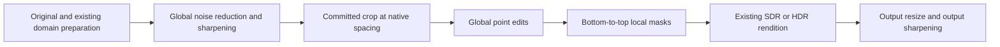

# Masked Texture: ordered integration

## Status and selected deliverable — 2026-11-15

[Issue #80](https://github.com/VaclavKlima/Irodori/issues/80) now includes the
user-selected full application integration, following the bounded study,
ordered proof and initial SDR consumer slice. Production preparation, native
HDR/authored-pair consumption, browser HDR presentation/histograms, root
settings/history and UI/API/MCP are implemented locally. Raster WebGL2 retains
its original source and overlays private Float32 candidate/union resources after
the unchanged legacy pass. Native pixels outside the Texture union and at alpha
zero retain exact legacy output; Fit compatibility applies outside the affected
sampler footprint. Current-device background functional acceptance is complete.
**Required native foreground
visuals, physical HDR and other-device acceptance remain pending.**

The [full application status](masked-texture.md#full-application-integration--2026-11-15)
records the current contract. Preserve the frozen LLF method, masks, sources,
amounts and prior feedback. Optional Texture remains integer −100…+100 with
neutral default 0. The historical study and design sections below retain their
original evidence, prospective wording and effort stops; they do not override
the later user authorization or current implementation notes.

## Production integration contract — background acceptance complete

- `mask-stack-preparation.ts` owns full native-grid preparation in the existing
  isolated preview worker. It reuses shared global/local point and canonical
  coverage programs around the frozen Texture operator. Existing Detail/crop
  owners finish first. Each bottom-to-top root consumes the previous complete
  Float32 prefix and performs one final coverage blend after Texture and its
  existing Balance/Light/Saturation operations. Signed domains, alpha and exact
  neutral/empty bypass remain explicit.
- Root `texture` is part of strict settings 20/catalog 30 migration, every history
  snapshot, mutations/resolution, duplication, capabilities and effective pixel
  identity. With active Texture, earlier point/coverage/order edits invalidate
  derived spatial work without redefining the original source identity.
  Main-owned frozen requests and source/publication checks prevent stale reuse.
- Main previews retain the original post-Detail/crop working source under its
  own lease. The prepared candidate and Float32 union have separate identities,
  hashes, bounded-strip descriptors and managed URLs. Active requests/streams
  pin their actual cache owners. Corrupt derived files invalidate their entry;
  valid original parents remain reusable. Curve/range/Before taps do not consume
  the baked creative prefix as an ordinary source.
- Native SDR/HDR output uses the unchanged legacy point/rendition pipeline plus
  explicit render-only candidate consumption and GPU native-word selection.
  Authored HDR content and its SDR primary are prepared independently. Additional
  masked-alpha peak passes reuse the unchanged native shaders to derive selected
  **unrounded** HDR headroom under the existing policy, preserving metadata
  semantics instead of reducing unpacked half values.
- HDR presentation retains its original texture and adds private, verified
  candidate/union textures and mip chains. The unchanged legacy cache pass runs
  first; the prepared pass writes only positive union/visible alpha. Neutral
  Before is not overwritten. The frozen point key fences later drafts; prefix
  keys distinguish private owners and presentation-cache entries. Prepared
  histogram selection evaluates the existing rendition once after choosing its
  point input. Exact legacy GPU programs are reused during profile compilation.
  Raster WebGL2 likewise retains its original source and draws a private Float32
  candidate/union overlay after its unchanged legacy pass. Native pixels outside
  the Texture union and at alpha zero retain exact legacy output. Fit retains
  legacy presentation outside the affected sampler footprint, while filtering
  and mips may include neighboring Texture pixels. Encoded proof bitmaps do not
  replace the original source.
- Parent/prefix/union/transport/renderer/crop/edge buffers share the unchanged
  admission snapshots and actual device limits. The 24 MP bound is a ceiling,
  not promised admission. Failure/cancellation drains owned work and preserves
  authored settings; no CPU feature fallback, lower-resolution retry,
  normalization/clipping or relaxed gate is added.
- Transient uncropped framing omits Texture while preserving Light/Color. The
  crop inspector explains that Texture resumes after Apply; committed crop
  changes rebuild the prefix. Exact HDR service statistics/pixels and native
  clipping with active Texture refuse until their point-only protocol is
  qualified for the spatial stage. Interactive histograms and output remain
  separate supported consumers.

[Reconciled background acceptance](masked-texture.md#full-application-integration--2026-11-15)
covers **1,169 distinct passing cases** on RX 7900 XTX across the selected
registered stages and exact corrective reruns. The original raster watchdog
failure remains failed evidence; it is not rewritten as a clean invocation.
Pixel/word gates remain unchanged. Eleven additional native producer/HDR cases
pass on actual integrated RADV Raphael-Mendocino. Browser selectors still chose
ANGLE RX 7900 XTX, so browser iGPU acceptance remains unverified.

Earlier failed attempts, exact reruns, original photo preferences and
shader/metadata gates remain retained. Two required native foreground visual
cases await explicit approval and execution; physical HDR and broad photographic
or performance acceptance remain separate. Local ignored reports remain under
`artifacts/masked-texture/2026-11-15-full-delivery/`; GitHub owns publication status.
Other-device verification remains
[#122](https://github.com/VaclavKlima/Irodori/issues/122).

## Shared SDR consumer slice — 2026-11-15

This section retains the earlier consumer-only checkpoint. Its feature/HDR
refusals describe that slice; the production status above records the later
user-selected integration and its current verification limits.

The user selected explicit shared-consumer integration after the ordered photo
review. Main-owned `PreparedMaskStack` metadata is now distinct from an ordinary
`WorkingAsset`. It binds the complete global/local point prefix, native parent,
grid, domain/transform/white balance, effective point edits, frozen Texture
identity and candidate/Float32-union hashes. Pending or stale receipts refuse.

`createPointGpu` has an opt-in paired consumption method. It runs the unchanged
legacy shader, a separately compiled render-only candidate branch and a GPU
native-word selection before resize/output sharpening. Outside the union and at
alpha zero, actual legacy native words are retained. Candidate RGB is already
coverage-blended; the consumer does not blend coverage again. Invalid Float32
coverage, nonfinite pixels and changed alpha refuse explicitly. Extra buffers
and concurrent crop/edge/base owners count against the same frozen admission.
Ordinary shader generation stays unchanged when the option is absent.

`PreviewProcess.renderPreparedFull` passes a separate internal request through
the isolated preview worker. It publishes only an identified SDR RGBA result,
without a reusable linear source. Ordinary prepared-source lineage/reuse refuses
that consumed result. Frozen `exportRenditions` accepts the same typed request,
validates it against actual Detail/crop geometry and hashes the actual legacy
strip stream before returning a completed output. Source/curve/range/neutral
Before taps and ordinary unprepared jobs retain their existing owners.

This is an internal consumer boundary for raster or scene-linear input to SDR
output. Prepared HDR output/authored HDR pairs are explicitly refused; renderer
HDR presentation and exact analysis are unchanged. A production Texture
preparation operation, source leases/publication/cache scheduling, persisted
Texture controls/history, UI/MCP and full-source transformed/tiled photographic
acceptance still need their own selected work. No full feature is enabled.

Focused targets are `prepared-mask-stack` and `prepared-mask-consumer-gpu`;
the latter exercises the real common renderer, preview worker and frozen output
using small synthetic pre-rendition inputs. It qualifies consumption, not the
Texture producer or new photographic quality. Local attempts and final receipts
are retained under
`artifacts/masked-texture/2026-11-15-consumer-integration/`.

### Focused current-device checkpoint

Final `prepared-mask-stack` / `prepared-mask-consumer-gpu` verification passes
**1,084 cases, zero failures/skips, 71.17 s**, including type/lint/format/build
and ordinary cheap Node checks:
`artifacts/verification/2026-11-15T12-19-24.847Z-check-SzwFDS/summary.md`.
The eight actual native/worker/frozen-output cases pass on RX 7900 XTX / RADV
Mesa 26.2.6. The same eight cases also pass in **14.34 s** under the isolated
integrated-Radeon selector, with actual RADV Raphael-Mendocino annotations:
`artifacts/masked-texture/2026-11-15-consumer-integration/integrated-01/playwright.json`.
Earlier affected `shared-rendering`, `export-gpu` and `detail-export-cache`
regressions pass **22 cases**; their unchanged results are reused from the
retained second invocation. The 60-second routine warning remains recorded;
these timings are verification evidence, not interactive-speed acceptance.

Retain all initial failures: an invalid synthetic brush radius was corrected
from 0.55 to 0.25 without changing the Texture method; raw RGBA thumbnail input
was corrected to the supported buffer path; the new receipt now canonicalizes
only verified identity crops so equivalent preview/export representations match.
Actual crops and false identity declarations still refuse. Exact failed cases
were rerun first. The request and its receipt are frozen before asynchronous
worker setup; the worker tests change the caller's object to verify isolation.

No app feature, photographic/HDR quality pass, foreground launch, full
checkpoint, commit or push follows from this checkpoint. Production Texture
preparation remains research-only; new live source leases/cache scheduling,
publication and schema/history/UI/MCP integration are not delivered here.
Other-device consumer verification is tracked separately in
[#122](https://github.com/VaclavKlima/Irodori/issues/122), pending publication
of an identified source commit and access to macOS/Windows hardware. #80 remains
open and in progress.

## Historical design baseline: prepared native crop grid

The current pipeline is:



Insert ordered Texture **inside E**, with the global point result D available
on the complete grid. Do not add it beside global Detail or move Light/Color
before crop. Nonlinear point edits and crop resampling do not commute.

| Current owner                                                       | Audited contract                                                                                                          |
| ------------------------------------------------------------------- | ------------------------------------------------------------------------------------------------------------------------- |
| [Full preview preparation](../../src/main/full-previews.ts#L1808)   | Global Detail, then committed crop, then point/render consumers                                                           |
| [Frozen renditions](../../src/main/export/renditions.ts#L259)       | Detail and crop before point rendering; resize follows rendition                                                          |
| [Crop geometry](../../src/shared/crop.ts#L166)                      | Oriented/lens-corrected crop output has unit native spacing, rotation/translation and floored dimensions; no hidden scale |
| [Inspection context](../../src/main/agent/inspection-source.ts#L60) | Already names this grid `oriented-lens-corrected-cropped-photo`                                                           |
| [Local mask program](../../src/shared/masks-gpu.ts#L656)            | Top-first descriptors execute bottom-to-top after global point edits                                                      |

Propose a separate integration policy, `masked-texture-cropped-stack-v1` (a
design identifier, not an active rendering version):

- Run on the full authoritative prepared crop, before output resize and before
  display sampling. Neither CSS zoom, overview pixels nor presentation tiles
  choose Texture scale.
- Use crop-local origin `(0,0)`, native centers `(x+.5,y+.5)`, existing ceil-half
  pyramid dimensions and the frozen finite-level clamp rule. Preserve actual
  linear-sRGB or Rec.2020 primaries, signed values and alpha.
- Sample each root's complete final coverage through existing
  [canonical mask geometry](../../src/shared/mask-geometry.ts#L92). The coverage
  coordinate system and the Texture filtering lattice are distinct.
- Cropping invalidates the entire ordered result. Odd integer crop origins can
  change decimation phase throughout; quarter-turn/straighten changes filter
  orientation; crop-edge clamp does not read discarded outside-crop pixels.
  No invariant uncropped-sensor phase, rotation equivariance or outside-crop
  neighborhood is promised. Lens-corrected spacing is not original sensor pitch.

The research examples used identity crop. They do not qualify these additional
geometry decisions. Keep their policy/file hashes untouched and test this new
integration policy explicitly before enabling affected geometry.

## Ordered root semantics

Let `P` be the preceding complete Float32 point-space result, initially the
existing domain-specific global point result. For each enabled root from bottom
to top, with final coverage `M` and signed amount `a`:

```text
T = P                         when a == 0
T = unblendedTexture(P, a)     otherwise, using neighbors in the complete grid
C = existingBalance(T)
C = existingSixLightOperations(C)
C = existingLocalSaturation(C)
next = existingMix(P, C, M)    exactly one final coverage blend
```

Retain the actual current `mix` expression and operation order, including neutral
skips, scene/raster white conventions and nonfinite refusal. Do not replace it
with an algebraically equivalent expression and assume identical Float32 words.
Copy preceding RGB/alpha words directly at zero coverage. At alpha zero, Texture
itself yields `T=P`; retain existing Balance/Light/saturation/mix behavior, which
can still change hidden RGB. Do not bypass a Light/Color-active root merely
because alpha is zero. Final compatibility selection preserves the actual legacy
hidden RGB/alpha words. Disabled/wholly neutral roots do no work. If all Texture
amounts are zero, use the current complete legacy route, without a spatial job.

The [research GPU composite](../../scripts/research/masked-texture/gpu.mjs#L87)
already returns `P + M*dY`. It cannot be fed into this recipe and blended again.
The next proof must expose the same frozen field/reconstruction as an unblended
candidate and combine it with shared mask Balance/Light/Color once. No second
filter or CPU implementation is selected. Texture-only roots must survive
activation, packing, range/edge preparation and current neutral-config skips.
Texture belongs to roots, not coverage operands.

Point-only roots between spatial roots consume the preceding result normally.
A later Texture root sees earlier Texture **and** earlier Light/Color changes,
including neighboring pixels beyond its own coverage. A field prepared once from
the original image cannot represent this stack. Do not sum amounts or reorder
nonlinear operations. The newly factored composite is a new integration policy;
inside active coverage retain the frozen numerical bound, not a new promise of
word parity with the research composite's different arithmetic expression.

## Typed preparation and consumption

Add one main-owned isolated-Dawn ordered preparation operation through the
existing preview worker and typed `PreviewProcess` boundary. Reuse that owner
from preview and frozen-output preparation after their Detail/crop owners.
Keep processing out of Electron; do not add a platform-specific backend.

Propose an internal `PreparedMaskStack` contract, distinct from an unedited
`WorkingAsset` and its current Detail/crop lineage. It must carry:

- Immutable upstream lease/identity and native crop/grid/mask geometry.
- Domain/rendition identity, primaries, white/transform and relevant global
  point/render policy identities. Authored HDR content and SDR primary are
  separate domains, not interchangeable planes.
- Frozen ordered effective root/coverage/amount/Light/Color identity and the
  exact consumed operation prefix. A complete result says global and local
  point edits are consumed; it is not an ordinary source plus neutral settings.
- Final pre-rendition Float32 RGB, unchanged alpha and a source-bound union of
  final enabled nonzero-Texture coverages, `U=max(M_i)`; include hashes,
  dimensions and actual output policy. HDR-derived descriptors update the
  whole image and every 64-row strip hash.
- Explicit pending/complete/publication state, versioned identity and disposal
  ownership. Renderer/agent requests still use managed IDs, never arbitrary paths.

Do not redefine [workingSourceIdentity](../../src/main/working-assets.ts#L61)
to mean a baked creative result, or masquerade this as `detailSource`:
[prepared lineage](../../src/main/prepared-preview-lineage.ts#L17) and
[export reuse](../../src/main/export/detail-policy.ts#L38) currently validate
only upstream/Detail/crop contracts. Both must explicitly understand the new
stage before reuse. Keep original authored edits attached to history, but give
consumers an explicit render-only mode that cannot apply consumed edits twice.

### Preserve actual legacy output outside Texture

Materializing globals or point segments can change rounding/FMA behavior even
when the same mathematical functions are reused. Comparing only to the new
candidate's own input would miss that regression.

Keep the original pre-point parent and the actual legacy consumer available.
At the pre-rendition point boundary, select the prepared stack only where
`U>0` and alpha is positive; elsewhere retain the existing complete legacy point
result. This is mathematically sound: downstream point edits are pointwise, and
every later Texture can publish changes only through its own root coverage,
already included in `U`. Never quantize analytic coverage to R8 just to form `U`.

This dual-input mode is **proposed and unproved**. Its exact selection boundaries
are scene-linear local RGB before ACES, raster RGB before authored transform/
clamp, and authored-HDR content before its clamp plus an independently prepared
SDR-primary result. Preserve each consumer's existing alpha/compositing policy.
Do not infer that adding a branch preserves old compiler output.

The first proof must compare against an unchanged actual consumer and require
exact native output outside `U`, exact neutral/disabled/zero-coverage paths and
exact preceding working words at each zero-coverage root. If a refactored consumer
changes outside-union output, retain the legacy native rendition separately and
GPU word-select its SDR/HDR output outside `U` **before resize/sharpen/encoding**.
That is an explicitly admitted compatibility path, not CPU repair or a second
processing backend. Pre-rendition working-word guarantees still need their own
proof; copying a final PNG alone is insufficient. Stop on a failed exact gate;
do not relax it or silently adopt changed unmasked appearance.
HDR peak/headroom reductions and dependent encoding metadata must follow the
selected combined output using the existing policy and reduction stage, or be
proved unchanged. Copied output words paired with a differently rounded candidate
peak are not an exact compatible frozen HDR result.

## Consumers and intentional source taps

| Consumer                                       | Required integration / retained limit                                                                                                                                                                                                                                                                    |
| ---------------------------------------------- | -------------------------------------------------------------------------------------------------------------------------------------------------------------------------------------------------------------------------------------------------------------------------------------------------------- |
| SDR preview and statistics                     | Consume the same prepared stack once; statistics still follow the completed exact `full.rgba`/render identity.                                                                                                                                                                                           |
| Scene-linear HDR preview and histogram         | Current [tile shader](../../src/renderer/src/preview/hdr-shader.ts#L72) and [histogram](../../src/renderer/src/preview/hdr-histogram.ts#L31) apply globals/masks themselves. Add explicit consumed-stage support and actual-consumer unmasked gates; never attach old active parameters to baked pixels. |
| Authored HDR / gain-map primary                | Preserve and process both the Rec.2020 content and authored sRGB primary with their own transforms/point conventions; use the same geometry/coverage. No HDR-to-SDR-primary substitution.                                                                                                                |
| Frozen export, output proof and SDR inspection | Reuse the same prepared stage; retain expected revision, frozen targets, native grid and downstream resize/output sharpening. Preserve the existing neutral Before owner and its unfiltered ancestor, not just the immediate post-Detail parent.                                                         |
| Exact HDR service statistics/pixels            | [Already refuses masks/other unsupported edits](../../src/main/processing/hdr-processing.ts#L66). Retain explicit refusal until a qualified GPU consumer exists; do not report complete analysis support.                                                                                                |
| Curve targeting                                | Preserve the [pre-curve Light/WB source tap](../../src/main/full-previews.ts#L2312). Final Texture output is not a replacement for the source-space targeting input.                                                                                                                                     |
| Range classification / coverage                | Preserve [neutral uncropped canonical preparation](../../src/main/mask-ranges/service.ts#L398), with no feedback from Texture. Coverage preparation remains source-stable.                                                                                                                               |

Neutral Before also zeroes global noise reduction and sharpening through
`neutralInspectionSource`, while the immediate compatibility parent already
contains global Detail. Retain the existing unfiltered decoded/corrected ancestor
and neutral preparation with matching crop/geometry; neutral parameters cannot
undo a baked Detail or ordered result.

## Dependencies, identity and authored state

An ordered prefix key must include the upstream/domain/grid identity, active
global point context, frozen Texture/grid policy, ordered effective coverage,
enabled/inverted/composed operations and preceding Balance/Light/Color/Texture.
Names, selection and UI expansion are not pixel inputs. Reorder, earlier edits,
geometry, source or policy changes invalidate downstream spatial results.
Coverage or local Light/Color does not mathematically change that root's input
field, but does change its output and downstream fields. First implementation
may conservatively rebuild the complete active stack; no per-mask prefix cache or
interactive-speed claim is selected by this design.

Current [source-change classification](../../src/main/catalog/domain.ts#L159)
and [spatial control key](../../src/shared/detail-controls.ts#L91) cover global
Detail, while point edits normally reuse prepared pixels. With active Texture,
global point edits and earlier local edits also invalidate spatial work. Add a
separate derived-stack identity/invalidation contract through existing event,
preview/request and stale-result owners; do not conflate it with canonical source
identity or invalidate source-stable range bases unnecessarily. A prepared stack
must never be presented as fresh after its consumed edits change. During drag,
retain honest local feedback/pending state and existing commit/cancel/Undo rules;
do not apply a new point draft on top of a stale consumed prefix.

At implementation, extend root descriptors/resolved masks, strict validators,
mutation create/update/duplicate/resolve, capabilities and effective pixel keys.
Current [mask contracts](../../src/shared/masks.ts#L76) and
[activation/packing](../../src/shared/masks-gpu.ts#L229) see only Light/Color.
Current settings version is 19 at this audit; recheck and reserve the next version
when implementing. Follow [editing migration](../../src/main/catalog/editing-migration.ts#L145)
for current settings **and every history snapshot**, with neutral amount 0 and
unchanged cursor/revision/timestamps. Version affected stage/render/cache
contracts without changing unrelated decode policy. Do not migrate now.

## Bounded ownership, cancellation and failure

The first ordered proof uses complete native frames, one spatial operation at a
time. Keep the immutable source lease and at most current/next unpublished prefix
slots; retire the old prefix only after the new one validates and GPU work drains.
This two-prefix bound assumes Texture reconstruction, shared local edits and the
single coverage composite are fused in one output pass. Spilling an unblended
candidate adds another full frame/file and must be charged explicitly.

Retain only the final validated cache entry, not one full image per root. Original
parent, coverage/union, candidate, any legacy compatibility rendition and dual
authored renditions are additional live owners, not hidden inside "two prefixes".
Account RAM backing allocations, upload/readback, pyramid/field, mask atlas/edge
preparation, strips, proof/presentation owners, scratch files and native outputs.
Drain filter buffers before point proof when possible; otherwise admit their sum.

The frozen maximum 24 MP is a ceiling, not guaranteed admission. The existing
research allocator needs **2,155,048,576 GPU bytes for 6000×4000 before other
owners**, already above conservative 2 GiB. Retain actual adapter buffer/binding
limits and unchanged Automatic policy. Additional prefixes/union/paired planes
can refuse an image that passed the single-operator study. No override, silent
reduced resolution, clipping/exposure normalization or equivalent CPU retry.
Validate the frozen signed/asinh domain after global and preceding local edits;
a source admitted before those edits may be explicitly refused afterward.

Use [existing preview disk reservations](../../src/main/full-previews.ts#L2961),
pin protection, source leases, fresh `wx` destinations and publication checks.
Do not reacquire the same preparation queue through an enqueuing reservation
method; use the existing non-reentrant reservation pattern. Hold reservations
through GPU drain and scratch cleanup. Stale/cancelled work cannot rename/publish
over a newer revision, evict an active parent or replace a valid completed frame.
Preserve authored edits and the last valid display with honest pending/error
identity; report actual GPU/resource/domain failures and safe Retry behavior.

Global Detail's [three-strip plan](../../src/shared/detail-resources.ts#L198)
covers its own 13 px halo, not Texture's 32 px bound or composed spatial support.
Do not claim a tiled implementation by reusing it. Full-frame admission is the
first proof; tiled/composed-support work needs its own derivation and complete-
frame comparison if later selected. No optimization/performance study starts now.

## Smallest next implementation proof and stop gates

The next proposed deliverable is **one internal ordered-stack proof**, before
public settings/UI/history migration. Use internal frozen operation descriptions,
the existing shared GPU math and unchanged production consumer as reference.
Register deliberate new targets, proposed `masked-texture-order-model` and
`masked-texture-order-gpu`; these names are not registered by this document.

1. Start with tiny identity-crop linear-sRGB and scene-linear Rec.2020 arrays:
   active global Light/curves/Color, two overlapping roots, partial coverage,
   relative balance/Light/saturation before/after a Texture root, then two
   Texture roots. Exercise order/reorder, disabled, amount zero, empty coverage,
   alpha zero/partial, signed/above-white and explicit domain/resource refusal.
   Keep all existing RGB tolerance and exact-word/legacy-output gates. Independent
   small expected sequences must detect double blending and double point edits;
   an inverse amount is not expected to cancel after nonlinear ordered work.
2. Validate the typed consumed-stage identity and same result consumed once by
   the actual preview-proof and frozen-output owners. Check complete native
   unmasked output against unchanged legacy owners, with any baseline word-select
   accounted for. A self-input comparison or numerical reference alone is not
   this gate. Alpha/hidden and pre-rendition zero-coverage checks stay separate.
3. Qualify odd integer crop origins, quarter-turns and fractional straighten on
   small inputs, canonical coverage mapping and deterministic crop-local phase.
   Compare full-frame references at the **same** crop/policy; do not assert
   uncropped phase/rotation invariance. Do not enable transformed cases early.
4. Only after those gates, reuse one committed flamingo native case with active
   global/local Light/Color and frozen crop to expose an insertion regression.
   Keep the original study intact, use a fresh evidence directory, and stop on
   the first failed numerical/resource/identity/photographic gate. No new input,
   visual strength sweep, foreground launch or full checkpoint is implied.

Select existing regressions only when their owners change: `mask-color-gpu`,
`mask-compound-gpu`, `prepared-comparison`, `detail-resources`, `resource-policy`,
`detail-preview-cache-gpu` and `detail-export-cache` are relevant candidates, not
an automatic test list. Reuse passed photographic/numeric evidence for unchanged
math. Initial available-device proof uses RX 7900 XTX; qualify integrated Radeon
and linked other-device acceptance before claiming their support. Foreground
presentation/native interaction requires explicit user approval.

After the ordered proof, separately select typed consumer coverage (including
authored pairs and HDR presentation), persistence/history/API migration, then the
compact UI with an actual Console-open design review and final integration checks.
None of those is satisfied by this design or the earlier neutral photographic
study. #80 remains open; no commit/push is part of this slice.
