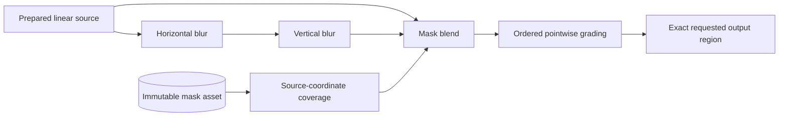

# Image-processing core research

Status: **research only; migration decision deferred**. The branch starts at `1fc4adaa014ba067e59b5e012c909cc721e3ecda` on clean `main`. Production editing, rendering versions, numerical thresholds, the typed bridge, history, and disabled controls are unchanged. There is no node editor, runtime plugin loader, or new application feature.

The experiment asks whether a region-aware internal graph can retain photographic detail and accommodate spatial/local operations while improving interaction and background completion. A faster blurred frame is not evidence of a better editor. Higher CPU/GPU utilization is not an acceptance criterion by itself.

## Findings and decision

The M4 Pro component experiment establishes a meaningful detail/performance tradeoff: full-detail exact ACES costs substantially more than the current bounded draft. Removing some per-batch completion waits helps, but does not establish sharp 60 fps. Do not promote the LUT or rewrite the service around a language microbenchmark. The results and remaining evidence below govern the next implementation decision.

The recommended sequence is:

1. Keep TypeScript/React and the current typed application service. Preserve Dawn and exact rendering while collecting equivalent Bazzite evidence.
2. Use the internal graph contract to prototype retained decoded/linear sources, explicit color/geometry boundaries, mask assets, and spatial dependency regions. Continue comparing full-detail completed frames, rather than submission latency.
3. Optimize identified boundaries independently: tile submission/fences, histogram readback, valid sharp navigation tiles, codec/decoder crossings, and buffer lifetime. Retain the current behavior behind an adapter until independent reference and end-to-end gates pass.
4. Consider a targeted native helper before replacing the whole worker service. Require actual individual/batch export and editing-during-processing evidence before choosing native components, Rust, or C++.
5. Evaluate shared textures and `wgpu` as separate experiments. Neither is a prerequisite for the graph, nor an established reason to replace Dawn.

These are recommendations from the code audit and local experiments, not a measured application speedup or an approved migration.

## Local M4 Pro observations

Measured on Apple M4 Pro (12 CPU cores, 16 GPU cores, 24 GiB), Darwin 25.6.0, Node 24.20.0, Electron 44.3.0 and Playwright 1.63.0. Experiments ran sequentially from the base revision above with a dirty research worktree; JSON records relevant source/fixture/lockfile hashes and native build manifests. Filesystem and driver caches were uncontrolled. The built-in workspace used device-pixel ratio 2. No physical scanout or luminance was measured.

### Detail and component cost

The native Dawn calibration uses a 1024 × 684 synthetic source, 914 × 502 CSS viewport, scale 1, and DPR 2. Each row contains 30 observations. Submission and completed-work boundaries are distinct; these are not Electron input latencies.

| Quality | Tiles/submission and waits | Histogram | Median / p95 completed work |
| ------- | -------------------------- | --------- | --------------------------: |
| Draft   | 8; wait per batch          | Off       |              1.82 / 4.16 ms |
| Draft   | 32; final fence            | On        |              2.52 / 2.62 ms |
| Normal  | 8; wait per batch          | Off       |            58.21 / 62.36 ms |
| Normal  | 8; wait per batch          | On        |            63.17 / 68.49 ms |
| Normal  | 32; final fence            | Off       |            51.47 / 52.26 ms |
| Normal  | 32; final fence            | On        |            56.32 / 57.04 ms |
| Normal  | 128; final fence           | On        |            55.26 / 56.48 ms |

Changing batching/waits reduces overhead but leaves this normal-detail workload above 33 ms. Histogram submission/readback adds measurable work; its mapping fence overlaps preceding rendering. These results do not establish the preferred cancellation policy or a production batch size.

The independent 192 × 128 high-frequency proof retains the unchanged exact GPU tolerance: maximum error/tolerance ratio **0.196**, with edge energy essentially equal to the CPU reference. The draft retains **0.0772×** reference edge energy and has mean absolute error **0.1865** in display-linear units. Its low latency comes with substantial lost detail. This synthetic edge-energy ratio is not a quality score for arbitrary photographs.

The added real-photograph calibration converts the licensed JPEG fixture to linear Rec.2020 and applies 4× exposure before exact ACES. Normal-detail maximum error/tolerance ratio is **0.0518**; draft edge energy is **0.4731×** reference, mean absolute error **0.1200**, maximum **1.5433**. It independently confirms the detail tradeoff on photographic texture, without certifying RAW color or the original authored JPEG rendition.

CPU preview LUTs remain a separate approximation experiment. On the real raster fixture, 17³/33³ LUT mean absolute errors were **0.0241 / 0.00629**, with maxima **0.1187 / 0.0391**, in display-linear units (1 = 100-nit reference white). Synthetic-pattern maxima were **0.2509 / 0.0628**. CPU evaluation was approximately 8.6–9.7 ms versus 33 ms for direct exact ACES at 192 × 128. This is not a GPU or application speed comparison. Neither LUT meets exact-rendering acceptance; generated contact proofs still require human visual review.

### Native correctness findings

| Component                | Local result                                                                                                                                                                     | Timing boundary and implication                                                                                                                                                                                                                                              |
| ------------------------ | -------------------------------------------------------------------------------------------------------------------------------------------------------------------------------- | ---------------------------------------------------------------------------------------------------------------------------------------------------------------------------------------------------------------------------------------------------------------------------- |
| LibRaw 0.22.1            | **Failed** maximum-two-code-unit research gate: maximum 589; mean 0.0000695; fraction above two codes `2.97e-7`. Worst sample: (2391, 863), red, native 46752 versus WASM 47341. | Thirty matching-version camera-linear decodes: WASM module-warm/fresh-decoder median 644 ms; native completed processing 443 ms; launch + file input/output 524 ms. Faster mismatching output is not equivalent. Investigate native/WASM compiler/SIMD/demosaic differences. |
| OpenCV 4.13.0 masked ECC | **Failed** `1e-3` matrix gate: maximum difference 0.005639553, repeated at 1/2/4 threads.                                                                                        | Thirty observations per thread setting: WASM about 121 ms; native launch about 50 ms, completed ECC about 46 ms. Extra threads did not materially improve this small calibration. This does not measure the custom patch-registration bridge or real merges.                 |
| Ultra HDR 2.0.2          | Passed dimensions, metadata and full reconstruction comparison; maximum half-code difference 0.                                                                                  | Thirty 256 × 192 encodes: WASM median 4.25 ms; single-thread native launch + input/output 4.50 ms. Tiny-job launch cost prevents an end-to-end benefit here. Linux and original-size candidate encoding remain separate measurements.                                        |

The LibRaw and ECC failures reproduced on diagnostic reruns without changing their tolerances. They are research findings, not regressions in production code. No native decoder/alignment migration is approved.

The final repeat measured LibRaw medians 637 ms WASM / 496 ms native launch-and-disk / 433 ms native processing. ECC measured 144 ms WASM and native launch medians 58 / 55 / 54 ms at 1/2/4 threads. Timing variation between invocations is retained; numerical differences were unchanged.

The unchanged edited-fixture export gate also failed during this research: fresh-worker p95 **6.946 s**, subsequent p95 **6.713 s**, against the existing **4 s** limit. The exact case rerun failed again at **7.127 / 6.437 s**. Both sets of 20 full jobs retained quality/dimensions, GPU source/rendering, native encoding and cleanup assertions. Individual source, GPU-tile and encoder stages varied together; their cause was not isolated. A power-status sample after the first failure reported AC power with the battery charging at 3%; thermal/power-warning counters were unavailable. This point-in-time sample does not explain the earlier runs. Preserve these failures alongside the prior four-second passes and earlier first-launch failure described in [testing](testing.md).

### Real work and first presentation

The production export baseline completed **30** original-size, quality-100 Sony RAW jobs and **three** heterogeneous batches (one RAW and two different JPEGs). Individual median/p95 were **3.705 / 4.308 s**, range **3.667–4.861 s**. Batch durations were **4.938, 5.018 and 5.057 s**. Output dimensions and original hashes were checked; export timings include durable publication and workers. This neutral-edit calibration does not replace the unchanged edited-fixture four-second export gate; the long tail remains visible.

At 1100 × 700 with Console open, three 240-input actual Exposure runs had p95 **18.1, 9.4, 17.4 ms** without export and **26.2, 9.3, 9.4 ms** with export. Missing presentations were 0/0/0 and 1/0/0. Every counted edit presentation was **draft**; normal refinement was awaited separately. Background jobs took **6.705, 6.204, 6.204 s**, measured with 100 ms completion polling. Foreground activity overlaps every input in these trials and slows background completion. This does not establish sharp 60 fps or interference for the other sliders or real merges.

Five fresh isolated application imports reached useful normal presentation in **2428, 2421, 2429, 2412 and 2411 ms**, reported individually. This clock includes fixture import/review and excludes main-process startup. The source and driver caches were not purged. Existing-library selection, fresh boot, fresh processing worker and cached revisit must not be combined under a single “cold load” number.

The final five-launch repeat measured **2443, 2456, 2459, 2491 and 2450 ms** under the same labeled conditions. Both cohorts remain available; no first-run outlier is removed.

The Electron capability inventory confirms shared-texture import/send APIs and the existing sandbox/context isolation, with Node integration disabled. No external-texture producer or transport benefit is established.

### Completed foreground presentations

The corrected research canvas uses production WGSL, validated managed RAW assets, `rgba16float` extended Display-P3, and production-equivalent device limits. A retained owned surface survives compute awaits; publication copies to the current canvas texture and fences completed work. Bounded upload strips do not remove Dawn's internal full-image initialization staging requirement. Initial request/texture-lifetime/limit failures remain in artifacts; their invalid frames are excluded from the results below.

Each cell reports all three 240-input runs. Latencies include the completed GPU work and following animation frame. Missing counts are essential: a low p95 among a small set of surviving frames does not establish the requested frame rate.

| Window / input rate                | Normal Fit p95, ms    | Normal 100% p95, ms | Missing Fit / 100%, per 240 inputs |
| ---------------------------------- | --------------------- | ------------------- | ---------------------------------- |
| 1100 × 700, Console open, 60 Hz    | 55.2 / 56.2 / 58.3    | 49.2 / 48.6 / 48.1  | 125 / 120 / 122; 93 / 89 / 86      |
| 1100 × 700, Console open, 120 Hz   | 50.2 / 48.6 / 48.9    | 42.2 / 39.4 / 42.5  | 179 / 179 / 177; 161 / 163 / 156   |
| 1440 × 900, Console closed, 60 Hz  | 142.2 / 134.6 / 142.6 | 84.2 / 84.4 / 84.6  | 197 / 206 / 206; 185 / 185 / 185   |
| 1440 × 900, Console closed, 120 Hz | 132.2 / 192.5 / 167.0 | 81.8 / 81.5 / 80.9  | 222 / 222 / 222; 207 / 208 / 207   |

The 800% normal-detail cases have a smaller visible source region. At 60 Hz their p95 is 16.9–17.6 ms with no missing inputs. At 120 Hz the smaller layout is 8.7–8.8 ms with 1–2 missing inputs; the larger is 17.9–25.2 ms with 108–112 missing inputs. All publication serials were monotonic. The native display reported 1800 × 1169 logical dimensions, scale 2, 120.0006 Hz and 30-bit color; measured idle rAF medians were 8.3–8.4 ms.

In the minimum-layout 60 Hz run, valid same-revision sharp navigation had warm p95 8.8–9.0 ms versus cold 25.2–31.1 ms over three 30-observation repetitions. This supports retaining valid sharp tiles for navigation, without mixing revisions. It does not prove cross-photo cold-load performance. These are shader-lab results; they bypass React/history and cannot replace the unchanged application benchmarks.

### Persistent CPU service transport

For 1024 × 768 RGBA Float32, the two ordered kernels produce byte-identical output in C++ and Rust. Each setting has three batches of 30 warmed observations, after five separately recorded fresh launches. Every photograph transfers 24 MiB plus 64 protocol bytes; one reusable native allocation owns 12 MiB per process.

| Aggregate compute threads / photos in flight | C++ median / p95 round trip | Rust median / p95 round trip | C++ / Rust photographs per second |
| -------------------------------------------- | --------------------------: | ---------------------------: | --------------------------------: |
| 1 / 1                                        |            11.30 / 12.07 ms |             10.71 / 13.43 ms |                       85.2 / 87.8 |
| 2 / 1                                        |            10.38 / 13.01 ms |              9.85 / 10.70 ms |                       88.7 / 95.7 |
| 2 / 2                                        |            12.10 / 13.32 ms |             11.79 / 13.04 ms |                     146.8 / 151.7 |
| 4 / 1                                        |             9.49 / 10.38 ms |              9.29 / 10.32 ms |                     102.2 / 104.7 |
| 4 / 2                                        |            11.11 / 12.39 ms |             11.04 / 15.27 ms |                     159.5 / 152.9 |

Single-thread compute alone was 2.31 ms C++ / 1.73 ms Rust; four threads reduced it to 0.62 / 0.47 ms. Transfer and ownership copies dominate the round trip. Two photographs improve aggregate transport throughput while increasing individual latency; real RAW/codec/GPU memory costs remain unmeasured for these candidates.

An earlier libc++ stream variant took approximately 185 ms per round trip despite similar compute. Disabling stream synchronization did not fix it. Replacing it with bulk POSIX read/write brought the C++ service into the same end-to-end range as Rust, retaining strict byte agreement. The earlier apparent language advantage was a transport implementation difference. This helper currently targets macOS/Linux; Windows transport is unverified.

Outstanding-request cancellation settled in approximately 0.9–2.4 ms; this includes transport and process termination, not a kernel-only checkpoint. Process RSS/thread counters are point-in-time samples including the shared test orchestrator and prior workloads, unsuitable for ranking candidate peak memory. No service migration or speedup in application exports follows from these two kernels.

Local evidence is retained under ignored `artifacts/verification/`:

- `2026-10-16T10-32-08.113Z-benchmark-syIlm4/summary.md`: static/build/265 fast cases passed; 19 research cases passed, four initial presentation-harness cases failed; 301.62 s. The JSON above comes from this run. Its original missing structured-attachment warning is retained; later harness commits add compact hashed measurement attachments.
- `2026-10-16T10-14-48.760Z-check-nqHtez/summary.md`: initial native/library measurements and unchanged two compatibility failures; 275 passed, two failed; 143.87 s.
- `playwright-1792146072916-12eda21a-ea65-49e6-b286-f624b759efe8/`: exact failing-case reruns for LibRaw and ECC with worst-pixel/all-thread diagnostics; both failed again.
- `playwright-1792147628852-9e662084-7214-4278-91f2-df76290e07f0/playwright/summary.json`: corrected minimum-layout 60 Hz case, one passed, 88.57 s, structured evidence attached.
- `playwright-1792147796412-3af41981-c834-457f-8be5-1b5c2e616c45/playwright/summary.json`: remaining layout/cadence cases, five fresh launches and capability inventory, nine passed, 207.57 s, no skips.
- `2026-10-16T10-55-49.343Z-benchmark-9pagYH/summary.md`: final graph/native/measurement/GPU selection, including real-photograph detail and bulk C++ transport, **277 passed**, no failures/skips/incomplete warnings, **43.85 s**. Type checking, lint, formatting and build passed; twelve exclusive research cases followed 265 fast cases.
- `2026-10-16T10-57-14.212Z-benchmark-WkC0kG/summary.md`: unchanged eight-slider Fit/100% and navigation gates, **269 passed**, no failures/skips, **63.27 s**. These gates permit drafts and do not establish retained detail.
- `2026-10-16T11-00-42.608Z-benchmark-XmHlIN/summary.md`: unchanged original-size edited HDR export gate, **265 passed, one failed**, **129.68 s**; both measured export p95 values exceed the preserved four-second limit.
- `playwright-1792148636653-053b1c3b-d4da-4c03-b456-0225e5185e1b/playwright/summary.json`: exact export failure rerun, one failed again, **123.10 s**, all 20 observations retained.
- `playwright-1792148836917-27d04ec7-1609-4d62-a36c-25230d8022df/playwright/summary.json`: final LibRaw/ECC failure reruns with embedded build manifests and structured attachments, two failed at the same numerical differences, **57.36 s**.
- `2026-10-16T11-11-49.710Z-benchmark-jleswI/summary.md`: final static/build/fast graph/native protocol selection, **270 passed**, no failures/skips, **15.2 s**, after the evidence-manifest changes. No comprehensive checkpoint was selected.

## Existing behavior and measurement boundaries

`src/renderer/src/preview/hdr-presenter.ts` computes a draft mip level from the visible source footprint and approximately 8,192 source pixels. Normal detail follows `hdrCachePlan`, independently of Retina density. A cold navigation request can use a draft; valid normal navigation tiles can survive continued input. `HdrRenderCache.setEdits` retires edited After tiles and retains neutral Before tiles. Content/SDR target identities are separate.

The presenter submits at most eight render tiles before a completion wait/cancellation check. Histogram work precedes the draws; histogram mapping after the draws also fences completed rendering. These costs overlap. A histogram-map fence is not a pure measurement of histogram execution. The research component probe records invalidation CPU time, command submission, batch waits, final completion, histogram submission, and map/fence time separately, and compares histogram on/off.

Existing slider benchmarks exercise all eight enabled HDR sliders at Fit and 100%, including sustained input and histogram completion. They permit draft quality. They remain unchanged; their speed gates do not certify retained detail. Existing preview/adjustment/HDR/export/merge benchmarks remain independently selectable through the existing verification runner.

## Internal operation contract

[Contract](../scripts/research/pipeline/contract.ts), [executor](../scripts/research/pipeline/graph.ts), and [repository operation modules](../scripts/research/pipeline/operations.ts) are isolated under `scripts/research/`. Production main, preload, renderer entry points, and clients do not import them.

Each recipe node declares operation/version, JSON parameters, named input/dependency IDs, output dimensions/channels, color domain, Float32 precision, alpha semantics, coordinate identity, and a cache/fusion boundary. Operation modules declare validation, CPU implementation identity, optional GPU implementation identity, the input regions required for an output region, and any immutable asset references. The reference executor runs CPU implementations only; the separate GPU experiment uses existing production WGSL. A declarative GPU identity alone does not implement a graph GPU backend.

The recipe stores intelligible edits and asset hashes. Execution plans, tile buffers, reductions, native processes, GPU textures, and caches are derived. Current settings are preserved verbatim by `adaptLegacy`, which requires pixels already prepared by the current pipeline. It deliberately does not reinterpret unsupported current adjustments as new graph operations. There is no catalog migration.

The masked-blur/grading proof composes these existing modules through the same executor:



The demand-driven model has precedent in [libvips regions, partial images, and operation caching](https://www.libvips.org/API/current/how-it-works.html). This prototype is an independent reference executor, not a wrapper around libvips or a decision to move Luma into its GObject runtime.

### Execution and invalidation

- The executor traverses named dependencies, rejects cycles/unknown versions/incompatible contracts, and pulls bounded regions. A streaming analysis reduction declares the full input dependency but consumes one tile at a time.
- Cache keys include operation/version, parameters, dimensions/domain/precision/alpha/coordinates, exact policy, requested region, and dependency identities. Revision numbers identify publication requests; identical pixel recipes can be reused at a later revision. Purpose is not a pixel transform: exact preview/export evaluate the same recipe.
- Mask fingerprints preserve zero-coverage tiles outside both old and new mask support. Downstream dependent keys change only where their requested regions see changed input content. Source and reusable upstream results survive downstream grading/mask changes.
- Compatible single-input pointwise chains fuse in order, with explicit Float32 rounding at each former intermediate. Shared or explicitly reusable nodes remain cache boundaries. Spatial filters, geometry, blends, and reductions are barriers.
- Separable blur declares source-pixel halos independently for each pass. Geometry declares inverse orientation, radial mapping, crop, and bilinear support. The radial prototype bounds its supported polynomial including optical-center edge extrema; it is not an arbitrary transform bound or a Sony lens provider.
- The bounded LRU pins dependencies during evaluation and recycles evicted allocations. The budget includes cached, pooled, live dependency, and current output buffers. The owned decoded source and outputs retained by the caller are reported separately. This is not an aggregate process-memory guarantee.

The reference executor currently accepts native scale and exact policy only. It explicitly rejects unsupported scale/approximation requests. A production graph still needs costed CPU/GPU partitioning, device resources, asynchronous tile delivery, buffer/transfer leases, and measured mip/approximation implementations. Implementing a module does not certify it for production.

### Masks, history, and geometry

The prototype follows [local-adjustment requirements](features/local-adjustments.md): masks use versioned normalized source coordinates, coverage is independent of photographic alpha, and feather radius is measured in source pixels using the smaller source dimension. The radial mask is an immutable content-addressed asset. `DurableMasks` stores JSON outside disposable tile caches, verifies its hash on read/orderly restart, and computes retained references across all current/undo/redo snapshots. Missing or corrupt history content is an explicit error. Crash-atomic publication/fsync, a production mask/history service and garbage collection are not implemented.

Orientation/lens/crop transform the photograph and mask using explicit inverse maps. Pointwise adjustments and blur preserve photographic alpha; the research geometry kernel interpolates straight channels. Transparent spatial filtering and premultiplied resampling need their own versioned semantics before production use. The CPU proof covers registration, order, feathering, tile seams, and the declared bounded radial geometry; it does not validate physical lens calibration, brush pressure, or arbitrary distortions.

### Extensibility proofs

| Workload                                 | Executable proof                                                                                                              |
| ---------------------------------------- | ----------------------------------------------------------------------------------------------------------------------------- |
| Exposure → grading                       | Order matters; fused and unfused Float32 results agree; reusable exposure/source survives grading changes.                    |
| Feathered mask + local exposure          | Separate coverage, source coordinates, preserved photo alpha, and localized invalidation.                                     |
| Blur at radii 0, 1, 3, 9 source pixels   | Two-pass dependency halos; fixed `5e-7` agreement against an independently computed untiled 2D filter, including edges/seams. |
| Masked blur → grading                    | Spatial and pointwise composition through the same executor and frame contract.                                               |
| Mask through orientation/lens/crop       | Four orientations and supported positive/negative radial mappings checked against independent coordinate calculations.        |
| Histogram → exposure parameter → grading | Full-image analysis streams once; downstream grading reuses it; upstream changes rerun it.                                    |
| Two image inputs                         | Named multiple-image dependencies and deterministic mean composition; not an HDR merge algorithm.                             |
| Additional sharpening module             | A test registers a new neighborhood operation without editing executor, scheduler, cache, or renderer transport.              |

## Candidate comparison

Rank by correctness/retained detail first, extensibility second, then interactive latency, background completion, resource efficiency, and maintenance cost. A candidate without equivalent evidence stays unranked on that criterion.

| Candidate                                               | Evidence and portability                                                                                                                                                                                                            | Maintenance and decision                                                                                                                                                                   |
| ------------------------------------------------------- | ----------------------------------------------------------------------------------------------------------------------------------------------------------------------------------------------------------------------------------- | ------------------------------------------------------------------------------------------------------------------------------------------------------------------------------------------ |
| Current TypeScript service + targeted native components | Existing production semantics remain the reference. The research C++ helper, native LibRaw/ECC, and native HDR encoder isolate particular boundaries. Cross-platform packaging and dependency licenses remain required.             | First candidate for an incremental measured change because it retains the application service and existing references. This is a risk/maintenance recommendation, not a throughput win.    |
| Rust/Rayon service                                      | Same owned Float32 frame protocol and ordered arithmetic as C++. Persistent local Rayon pool; bounded thread counts; five worker launches and warmed/repeated jobs. Rust does not eliminate native-library FFI or transport copies. | Useful ownership/scheduling candidate. Full RAW/color/geometry/codec equivalence and end-to-end gains are not established by two pointwise kernels.                                        |
| C++ service                                             | Equivalent persistent service; bounded persistent pool; reusable owned allocation. Direct C++ library integration can avoid some language/FFI crossings.                                                                            | More manual lifetime/cancellation/ABI work. Matching versions, SIMD, library thread pools, and platform link dependencies need explicit control. No full-service migration recommendation. |

The protocol has a fixed 32-byte request header (magic, dimensions, request ID, Float64 EV/curve parameters), bounded little-endian interleaved RGBA Float32 payload, and a matching response carrying completed compute time and owned capacity. It accepts no filenames, commands, shaders, or native handles. One service accepts one request; two-photo trials use two processes with a fixed aggregate compute-thread budget. Pipe transfer/copy cost is included in end-to-end timing and byte counts.

[Rayon's local thread-pool builder](https://docs.rs/rayon/1.12.0/rayon/struct.ThreadPoolBuilder.html) supplies the bounded Rust pool. The cooperative research scheduler prioritizes queued foreground work between bounded steps, caps admitted jobs at two, yields to the event loop, and closes cancelled generators. At capacity it rejects new requests, including foreground requests; this is an admission/cancellation proof, not a production foreground policy. Reserved foreground capacity or resource-releasing preemption and application-wide codec/library thread budgets remain required. Its synthetic tests do not establish protection during real exports/merges.

### Equivalent library comparisons

- LibRaw compares the installed WASM **0.22.1-Release** with matching native camera-linear 16-bit output, same AHD/white-balance/gamma/brightness settings and source fixture. Native file read/output and process launch are labeled separately from a warmed WASM module. A version mismatch leaves equivalence incomplete. [LibRaw documents the processing parameters](https://www.libraw.org/docs/API-datastruct-eng.html); the prototype is not a new camera decoder.
- OpenCV compares the existing masked `findTransformECCWithMask` call with the same native **4.13.0** call, masks, homography, stopping criteria and Gaussian size. One thread precedes 2/4-thread trials. Independent Accelerate/LAPACK, Carotene and KleidiCV paths are disabled in the fallback source build to avoid uncontrolled extra backends. The custom WASM SIMD patch-registration kernels are **not ported or measured** here. Native ECC alone cannot establish a merge speedup. [OpenCV's threading model](https://docs.opencv.org/4.13.0/d7/dff/tutorial_how_to_use_OpenCV_parallel_for_.html) does not account for unrelated libraries' pools.
- Ultra HDR compares the same unchanged bridge and pinned **2.0.2 / libjpeg-turbo 3.1.0** sources. A research-only source copy caps `GetCPUCoreCount` at 1 before any 2/4-thread build. Production/vendored binaries are untouched. Dimensions, full-size gain map, metadata and reconstructed half-float output are checked. Linux timing still requires Bazzite. [Upstream libultrahdr](https://github.com/google/libultrahdr) remains the codec reference.

### Shared textures and wgpu

Electron 44 exposes experimental shared-texture import/send APIs. The separate test inventories these and checks the existing sandbox/isolation preferences. An API being present does not establish transport throughput. [Import/release lifetime](https://www.electronjs.org/docs/latest/api/shared-texture), [texture metadata](https://www.electronjs.org/docs/latest/api/structures/shared-texture-import-texture-info), and [platform handle types](https://www.electronjs.org/docs/latest/api/structures/shared-texture-handle) define the next producer/receiver experiment.

The current Node Dawn binding has no tested producer/export ownership path for this experiment. A native IOSurface/Mach-port producer on macOS and DMA-BUF producer on Linux, synchronization, receiver death, stale generations, format/alpha/color preservation, and all-reference release remain incomplete. Do not expose handles through `window.luma` or MCP to bridge this gap. Continue using validated typed assets/frames.

[wgpu](https://docs.rs/wgpu/30.0.1/wgpu/) is a separate native Rust WebGPU implementation with platform backends. This PR retains Dawn. A fair switch experiment must hold WGSL, precision, adapters, transfer route, request sampling and completed-work boundaries constant. No wgpu throughput, HDR presentation, external-texture, or fallback certification is claimed here.

## Reproduce

Node 24+, npm dependencies and the existing Electron runtime are prerequisites. New Node tests use the registry; native/component workloads are exclusive and sequential. Electron uses the shared isolated launcher and temporary profiles, never a user library. Presentation cases require explicit foreground mode. No comprehensive checkpoint is implied.

The [Bazzite continuation brief](performance-research-bazzite.md) contains the Linux checkout, pinned native builds, test matrix and outstanding work for the unavailable second machine.

```sh
npm ci
npm run setup:electron
npm run research:pipeline
npm run verify -- --plan --target research-measurements --target research-libraries --target research-gpu

# Research C++ service; no library development packages required.
node scripts/research/build-native.mjs pointwise

# Rust toolchain already installed. Keep all build output outside source.
node scripts/research/build-rust.mjs

# Either matching development packages + pkg-config, or these pinned source archives.
mkdir -p artifacts/research-build
curl --fail --location https://www.libraw.org/data/LibRaw-0.22.1.tar.gz --output artifacts/research-build/LibRaw-0.22.1.tar.gz
curl --fail --location https://codeload.github.com/opencv/opencv/tar.gz/refs/tags/4.13.0 --output artifacts/research-build/opencv-4.13.0.tar.gz
node scripts/research/build-native.mjs libraw
node scripts/research/build-native.mjs opencv

# Reuse verified source.tar.gz/jpeg.tar.gz under artifacts/ultrahdr-native-build.
# On macOS these are fetched by the existing build:export-native command.
# Linux: download the same pinned archives there; see the hashes below.
node scripts/research/build-native.mjs hdr-1

npm run research:measure
npm run research:presentation -- --foreground

# Keep actual React input/history behavior and its original gates separate.
npm run verify -- --foreground --target hdr-slider-benchmark --target hdr-interaction-benchmark
```

`LUMA_RESEARCH_CARGO` selects the Cargo executable for an isolated toolchain. `LUMA_RESEARCH_PINNED_SOURCES=1` selects verified LibRaw/OpenCV archives even when pkg-config finds system packages; a mismatched system version is rejected. `LUMA_RESEARCH_RUST_BINARY`, `LUMA_RESEARCH_LIBRAW_BINARY`, `LUMA_RESEARCH_OPENCV_BINARY` and `LUMA_RESEARCH_HDR_1_BINARY` can select explicit research helpers; default paths are under `artifacts/research-build/<platform>-<arch>/` or `artifacts/research-rust/release/`. Helpers have adjacent build manifests. No binary is installed into the application. `CXX` selects a compiler executable, not a shell command.

The build helper verifies SHA-256 before extracting fallback sources:

| Archive             | SHA-256                                                            |
| ------------------- | ------------------------------------------------------------------ |
| LibRaw 0.22.1       | `a789dc4e2409e2901d93793a4e0b80c7b49d0d97cf6ad71c850eb7616acfd786` |
| OpenCV 4.13.0       | `1d40ca017ea51c533cf9fd5cbde5b5fe7ae248291ddf2af99d4c17cf8e13017d` |
| libultrahdr 2.0.2   | `aa8d193bb887c348c419780511dd03b374f4e07af8812b6d3f80c8537cf1ef2c` |
| libjpeg-turbo 3.1.0 | `35fec2e1ddfb05ecf6d93e50bc57c1e54bc81c16d611ddf6eff73fff266d8285` |

Only local developer tools and downloaded source archives are needed for research builds. LibRaw's single-thread fallback uses upstream `Makefile.dist` without optional JPEG/zlib/LCMS/OpenMP; it is not a distributable decoder configuration. Preserve upstream LGPL/CDDL, Apache/BSD-style and codec dependencies' licenses if any native component is later shipped. No fixture licensing or attribution changes.

## Evidence protocol and remaining acceptance

Every runner invocation creates its own ignored directory under `artifacts/verification/`. Read `summary.md` first. Per-workload JSON retains revision/dirty state, relevant source and package-lock hashes, compiler/options/binary identities where available, platform/backends, dimensions, display scale/cadence, observations and limits. Native GPU fences prove completed queue work, not timestamp-query hardware durations. Known owned GPU allocations and sampled aggregate process RSS/threads are not peak VRAM/RAM or aggregate per-job CPU time. Null metrics stay unmeasured.

The local methods include three 240-input sustained repetitions per quality/zoom/layout/rate supported by the display, five isolated fresh application imports reported individually, five fresh CPU worker launches, 30 warmed observations per workload, and three repeated synthetic CPU batches per concurrency/thread setting. Synthetic graphs, repeated-fixture calibration, transformed raster contact proofs and real RAW presentation remain separate. Unsupported display cadence is recorded as an incomplete skipped case, never silently called 120 fps. No filesystem/driver cache purge is claimed.

Preview LUTs use a signed asinh shaper over `[-0.25, 64]`, 17³/33³ Float32 tables and trilinear interpolation. Out-of-domain values use the exact reference. They reject export. Error reports include linear numerical error, edge-energy retention, seam-gradient error and local overshoot separately from human visual acceptance. Generated SDR contact proofs are labeled and do not certify physical HDR. Exact rendering keeps `2e-6 + 2e-5 * abs(reference)`; independent tiled blur keeps its fixed tolerance. Neither is relaxed for an approximation.

| Acceptance area                                  | Required evidence / current limit                                                                                                                                                                                                                                                                      |
| ------------------------------------------------ | ------------------------------------------------------------------------------------------------------------------------------------------------------------------------------------------------------------------------------------------------------------------------------------------------------ |
| M4 Pro and Ryzen 9 7900X3D / RX 7900 XTX Bazzite | Local M4 Pro only; Bazzite hardware/driver/display evidence remains incomplete.                                                                                                                                                                                                                        |
| Sharp 60 fps, p95 ≤33 ms                         | Report completed presentations, missing inputs and stale age with detail. Component results alone do not pass the target.                                                                                                                                                                              |
| 120 fps                                          | Measured separately; unavailable native cadence remains incomplete.                                                                                                                                                                                                                                    |
| First load                                       | Five fresh isolated applications include fixture import/review; navigation clock excludes main startup. Fresh worker, warmed module and cached tile revisit are separate. Fresh existing-library selection/full cold boot remain incomplete.                                                           |
| Background export/merge                          | Thirty production exports, three heterogeneous batches and three Exposure-during-export trials are measured above. Candidate service exports, overlap of preparation/encoding, other-slider interference and real merge throughput remain incomplete. Private real merge sequences are absent locally. |
| Efficiency                                       | Owned buffers, transfers, CPU-process counters, completed GPU fences and actual Exposure interference are measured. Aggregate peak RAM/VRAM, hardware timestamps, logical traffic and per-job CPU time for full jobs remain incomplete.                                                                |
| Correctness                                      | Prototype source/alpha/order/region/cache/history references and native output checks supplement existing production tests. Full originals/history/merge/export/HDR/fallback/cleanup regressions remain required at a later agreed migration checkpoint.                                               |
| Shared textures / wgpu                           | Capability/source investigation only; producer/ownership and equivalent end-to-end transport/backend measurements remain incomplete.                                                                                                                                                                   |
| Migration                                        | Require repeatable end-to-end benefits beyond observed variability, retained detail, extensibility and unchanged correctness gates. No architecture winner or production approximation approval yet.                                                                                                   |

Existing benchmark failures and evidence remain in their original invocation directories. Missing hardware, sources, baselines or required measurements cannot be converted into a successful migration checkpoint. This research PR can be useful while that decision remains open.
